# A2 – Truss Stress Analysis  

## Documentation Quality & Introduction  
Comprehensive technical documentation establishes a transparent engineering baseline, enabling external reviewers to rigorously evaluate the underlying methodology, safety margins, and structural design decisions with confidence.

  <figure style="display: inline-block; margin: 10px; vertical-align: top;">
    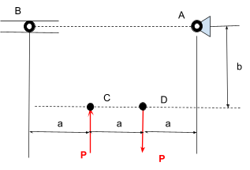
    <figcaption style="font-size: 0.85em; color: gray; margin-top: 5px;">
      Truss Configuration and System Overview Diagram
    </figcaption>
  </figure>

## Truss Geometry & Static Analysis  
### Geometry & Element Layout  
The overall truss configuration was designed with geometric simplicity to facilitate clear equilibrium calculations while maintaining structural stability. The member lengths were defined as follows: 

### Free Body Diagrams (FBDs)  
<small>***(Clicking on the images will enlarge them)***</small>  
Free body diagrams were sketched and labeled for each individual joint on the truss to isolate external reactions and internal member force interactions. Specifically, the FBD for Node C incorporates 

### Symbolic & Numerical Force Solutions  
Internal forces were solved symbolically across the joint equilibrium equations (e.g., &sum;Fy = FBC&middot;sin(&theta;1) + FCA&middot;sin(&theta;2) + ... )

  <figure style="display: inline-block; margin: 10px; vertical-align: top;">
    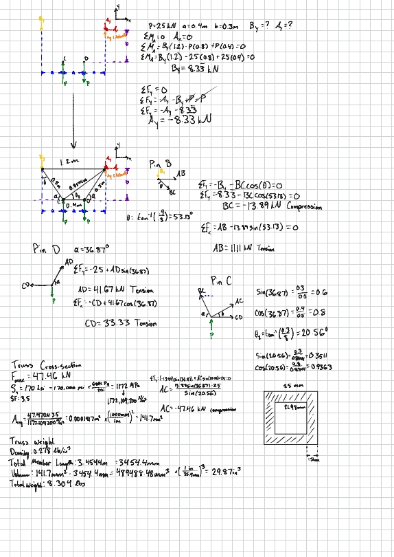
    <figcaption style="font-size: 0.85em; color: gray; margin-top: 5px;">
      Free Body Diagrams and Equilibrium Framework for Node C
    </figcaption>
  </figure>

  

## Truss Member Sizing  
### Calculations and Allowable Stress  
To determine the safety boundaries, hand calculations were performed to track known constraints against structural geometric requirements.  

*   **Knowns:** Maximum internal force Fmax = 47.47 kN, material yield strength Sy = 170 ksi (1172 MPa), and a safety factor SF = 3.5.  
*   **Unknowns:** Allowable stress &sigma;all and minimum required cross-sectional area Areq.  
*   **Symbolic Solution:** The allowable stress boundary was established by dividing the yield strength by the safety factor (&sigma;all = Sy / SF). Substituting this into the axial stress expression leads to the minimum area requirement.  
*   **Numerical Solution & Weight:** Substituting numerical values results in a minimum cross-sectional area of 0.0001417 m², or 141.7 mm², which satisfies the design objectives within the specified safety margin.

## Connecting Pin Shear Design  
### Structural Pin Parameters  
*   **Knowns & Quantities:** Shear force V = 47.47 kN, tensile yield strength = 170 ksi, shear yield strength &tau;yield = 0.5 &times; Sy, safety factor SF = 4, configured across the pin group.  
*   **Unknowns:** Allowable shear stress &tau;all and minimum pin cross-sectional area Apin.  
*   **Symbolic & Numerical Area:** The allowable shear stress boundary was formulated as &tau;all = (0.5 &times; Sy) / SF, yielding the symbolic area equation: Apin = V / (&tau;all &times; n).  
*   **Approximate Weight:** Assuming four pins with an individual length of 50 mm, the total pin volume equates to 3.95 in³. Multiplying by the material density (0.278 lb/in³) results in a combined pin weight of approximately 1.10 lb.

  <figure style="display: inline-block; margin: 10px; vertical-align: top;">
    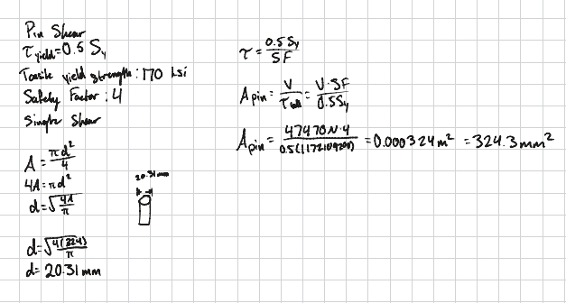
    <figcaption style="font-size: 0.85em; color: gray; margin-top: 5px;">
      Critical Pin Free Body Diagram and Shear Planes
    </figcaption>
  </figure>

  

## CAD Modeling & Mass Properties Verification  
A 3D parametric model of the truss structure was generated using CAD software. The framework was constructed to track the exact mathematical values calculated during the sizing phase.  

  
<small>***(Click on any image to zoom)***</small>

  <!-- ROW 1 -->
  

    <figure style="display: inline-block; margin: 5px; vertical-align: top; width: 22%;">
      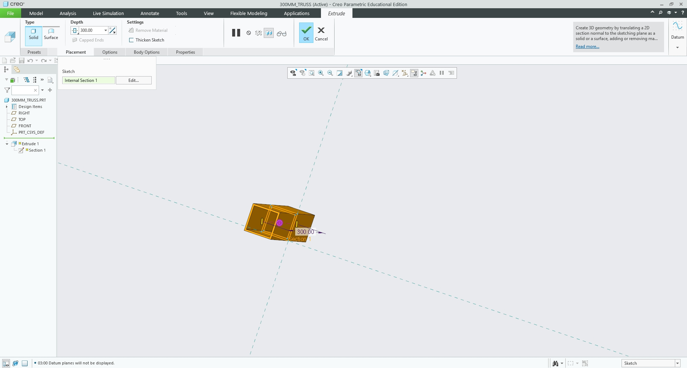
    </figure>
    <figure style="display: inline-block; margin: 5px; vertical-align: top; width: 22%;">
      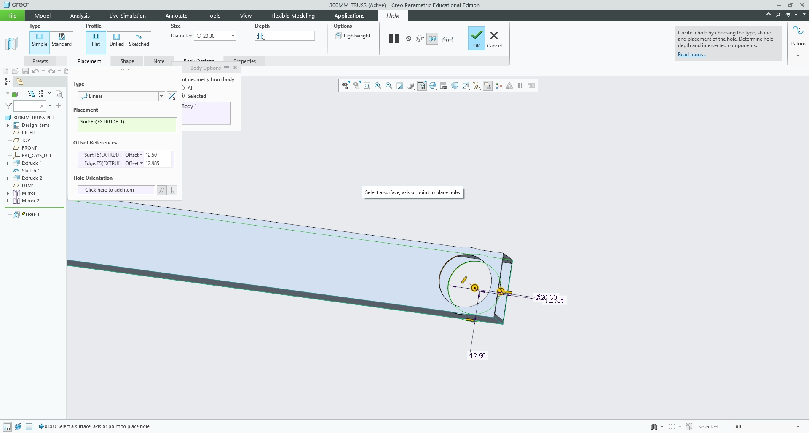
    </figure>
    <figure style="display: inline-block; margin: 5px; vertical-align: top; width: 22%;">
      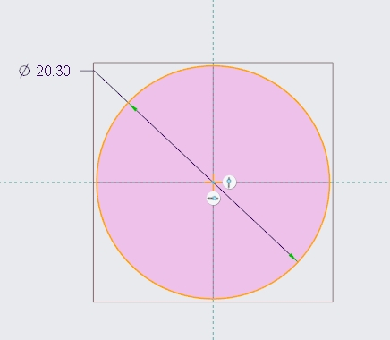
    </figure>
    <figure style="display: inline-block; margin: 5px; vertical-align: top; width: 22%;">
      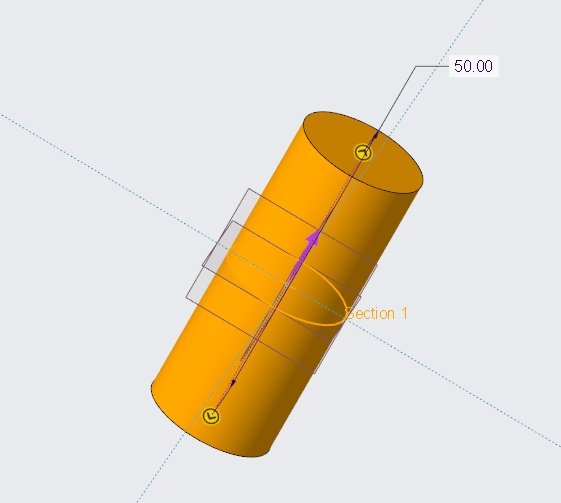
    </figure>
  

  <!-- ROW 2 -->
  

    <figure style="display: inline-block; margin: 5px; vertical-align: top; width: 22%;">
      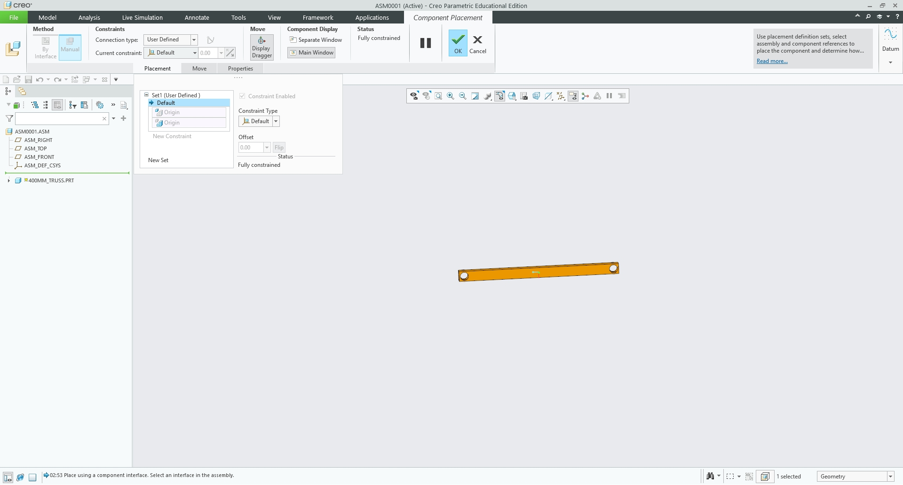
    </figure>
    <figure style="display: inline-block; margin: 5px; vertical-align: top; width: 22%;">
      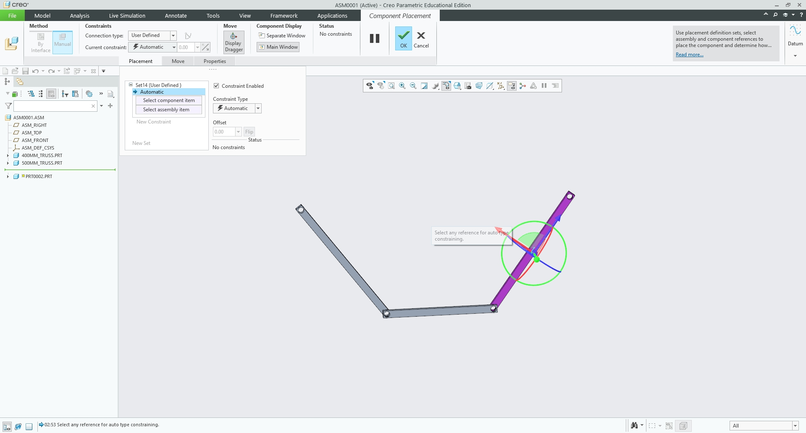
    </figure>
    <figure style="display: inline-block; margin: 5px; vertical-align: top; width: 22%;">
      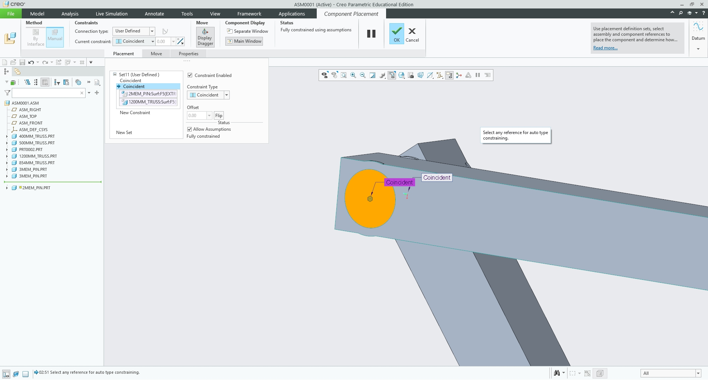
    </figure>
    <figure style="display: inline-block; margin: 5px; vertical-align: top; width: 22%;">
      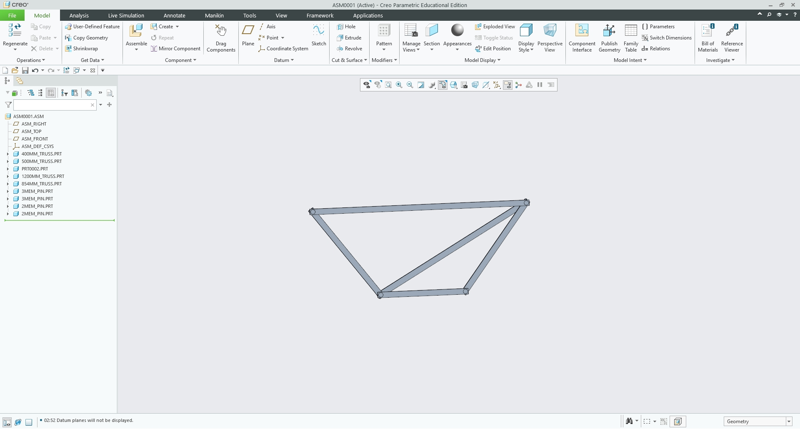
    </figure>
  

  <!-- Unified Label for the Grid -->
  

    Process from design to assembly
  

*   The truss framework (excluding connecting hardware) was successfully modeled as a single integrated part file.  
*   Connecting pins were modeled as discrete cylinders matching the calculated cross-sectional areas and an individual length of 50 mm, maintaining exact alignment.  
*   The cross-sectional area of each individual element was strictly preserved at the pin joint intersections to satisfy structural integrity, geometric constraints, and safety margins.  
*   Material density and mass properties were assigned within the CAD environment, enabling automated computation of the predicted total assembly mass and weight.  

## Engineering Lessons Learned  
The design process demonstrated how critical maximum internal force iterations dictate material cross-section selection when applying stringent safety factor thresholds. Balancing analytical stress equations with practical fabrication constraints was essential for producing a robust yet efficient truss design.

  
  <!-- PDF Report Download Button -->
  <a href="./MEGR%202156.pdf" download="MEGR 2156.pdf" style="
    background-color: #d32f2f; 
    color: white; 
    text-decoration: none;
    padding: 12px 22px; 
    font-size: 0.95em; 
    font-weight: bold; 
    border-radius: 5px; 
    box-shadow: 0 2px 5px rgba(0,0,0,0.15);
    display: inline-block;
    transition: background-color 0.2s;">
    📕 Download Truss Work PDF
  </a>

  <!-- ZIP Archive Download Button -->
  <a href="./A2.zip" download="A2.zip" style="
    background-color: #f57c00; 
    color: white; 
    text-decoration: none;
    padding: 12px 22px; 
    font-size: 0.95em; 
    font-weight: bold; 
    border-radius: 5px; 
    box-shadow: 0 2px 5px rgba(0,0,0,0.15);
    display: inline-block;
    transition: background-color 0.2s;">
    📦 Download CAD File .zip
  </a>

