# A7: FEA on Bracket

<small>***(Clicking on the images will enlarge them)***</small>

## 1. Documentation & Intent

The intent of this documentation is to capture the complete finite element analysis (FEA) and structural optimization process for the mounting bracket, extending previous work from Assignments #5 and #6. PTC Creo Simulate was utilized to drive iterative geometric optimization, ensuring high stiffness, high strength, and lightweight performance under a $600\text{ lbf}$ cantilevered load.

### Design Thought Process & Insights
- **Baseline Evaluation:** Initial structural evaluation of Design I revealed substantial solid mass in upper regions experiencing negligible stress utilization under bending loads.
- **Lightweight Strategy:** Material was selectively removed in lower-stress zones—first via parallel horizontal through-holes in the upper blocks (Design II), and subsequently via a centralized pill-shaped horizontal slot in the lower vertical web (Design III)—while preserving structural integrity around the T-slot constraints and lower load pin interface.
- **Geometric Refinement & Lessons Learned:** Early iterations demonstrated that sharp interior corners introduce severe stress concentrations. Transitioning to smooth, rounded semicircular radii on the pill slot in Design III eliminated stress risers and distributed load trajectories evenly across the ligament boundaries.

  <figure style="display: inline-block; margin: 10px; vertical-align: top;">
    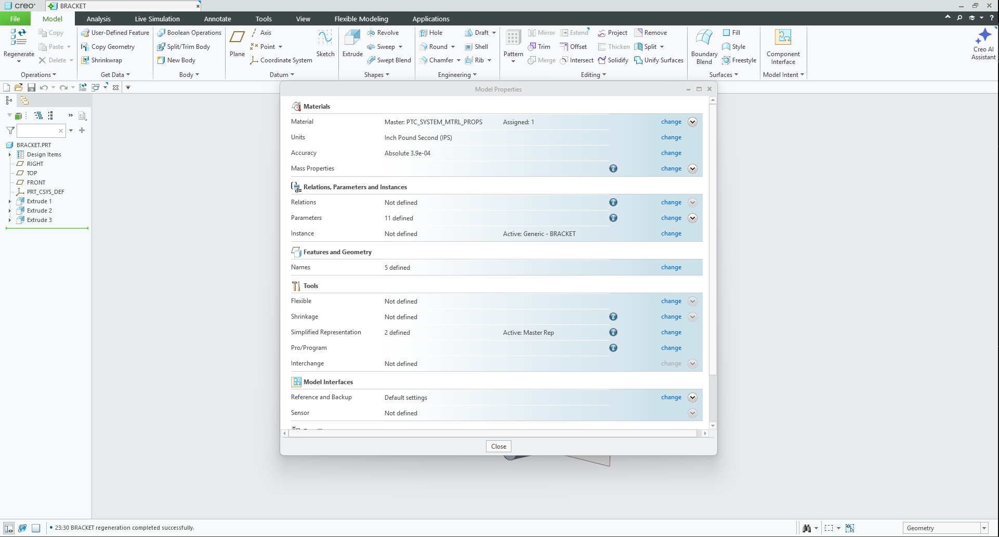
    <figcaption style="font-size: 0.85em; color: gray; margin-top: 5px;">
      Model properties and AL6061-T6 material assignment
    </figcaption>
  </figure>
  <figure style="display: inline-block; margin: 10px; vertical-align: top;">
    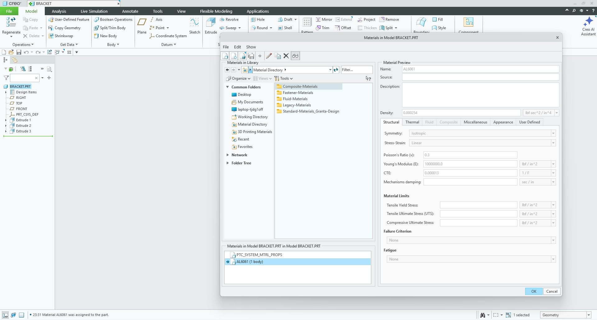
    <figcaption style="font-size: 0.85em; color: gray; margin-top: 5px;">
      Material library directory and property verification
    </figcaption>
  </figure>

  <figure style="display: inline-block; margin: 10px; vertical-align: top;">
    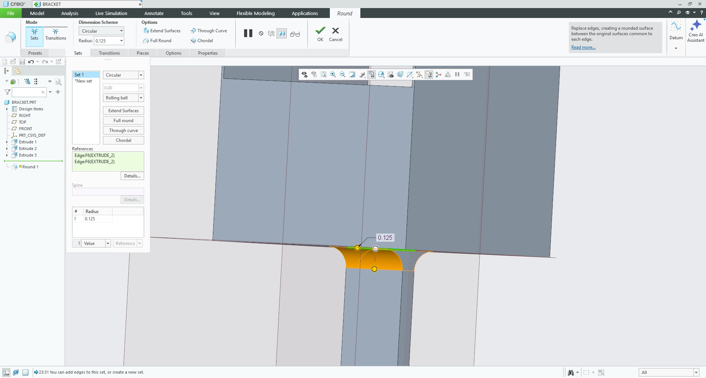
    <figcaption style="font-size: 0.85em; color: gray; margin-top: 5px;">
      Applying $0.125\text{ in}$ root fillet to mitigate stress concentration
    </figcaption>
  </figure>
  <figure style="display: inline-block; margin: 10px; vertical-align: top;">
    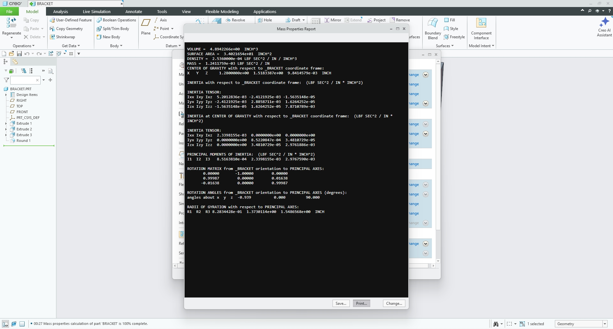
    <figcaption style="font-size: 0.85em; color: gray; margin-top: 5px;">
      Design I baseline mass and volume properties report
    </figcaption>
  </figure>

---

## 2. Preprocessing & Boundary Conditions

To establish a consistent numerical baseline across all outer loop iterations, identical boundary conditions and material parameters were maintained throughout the study:

1. **Static Stress Analysis:** Linear elastic static stress analysis conducted using PTC Creo Simulate.
2. **Material Definition:** Aluminum 6061-T6 ($S_y = 40,000\text{ psi}$, $E = 10 \times 10^6\text{ psi}$, Poisson's ratio $\nu = 0.33$). Material properties remained uncompromised across all iterations.
3. **Constraints Selection:** Fixed 6-degree-of-freedom boundary constraints applied to internal T-slot mounting contact surfaces.
4. **Loading Selection:** A static downward force of $600\text{ lbf}$ applied to the lower cylindrical loading pin surface.
5. **Mesh Selection & Refinement:** AutoGEM tetrahedral meshing initialized with default coarse parameters, followed by targeted local maximum element size controls ($0.25\text{ in}$ and $0.125\text{ in}$) for inner loop convergence verification.

  <figure style="display: inline-block; margin: 10px; vertical-align: top;">
    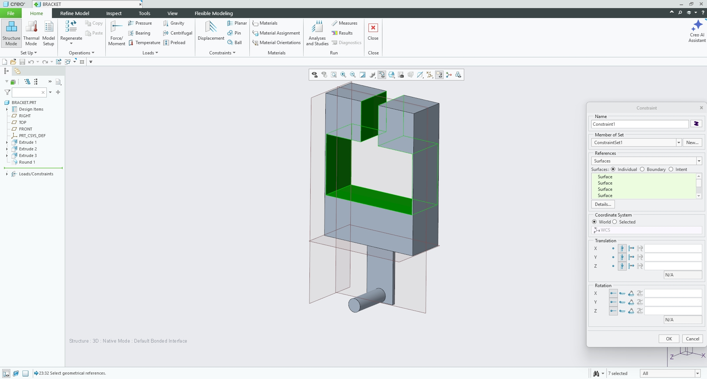
    <figcaption style="font-size: 0.85em; color: gray; margin-top: 5px;">
      Fixed boundary constraints applied to internal T-slots
    </figcaption>
  </figure>
  <figure style="display: inline-block; margin: 10px; vertical-align: top;">
    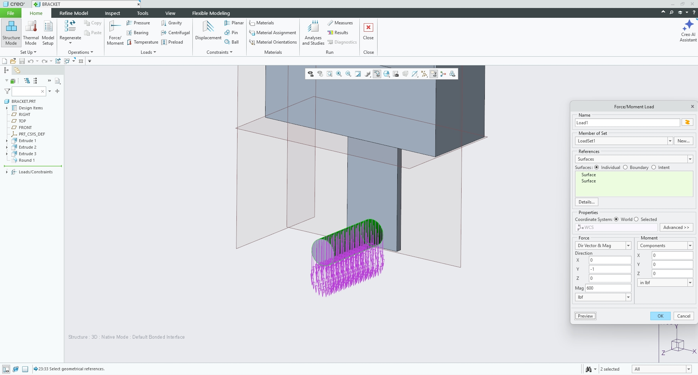
    <figcaption style="font-size: 0.85em; color: gray; margin-top: 5px;">
      $600\text{ lbf}$ static downward force on loading pin
    </figcaption>
  </figure>

  <figure style="display: inline-block; margin: 10px; vertical-align: top;">
    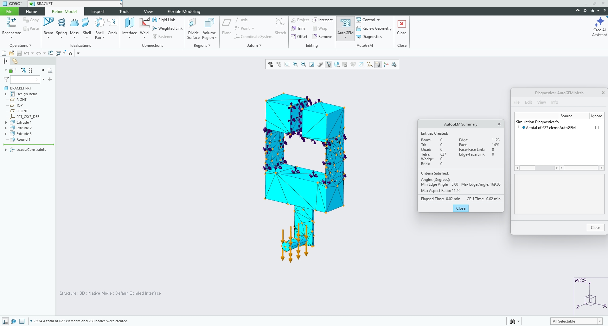
    <figcaption style="font-size: 0.85em; color: gray; margin-top: 5px;">
      Design I initial AutoGEM mesh summary (627 elements)
    </figcaption>
  </figure>
  <figure style="display: inline-block; margin: 10px; vertical-align: top;">
    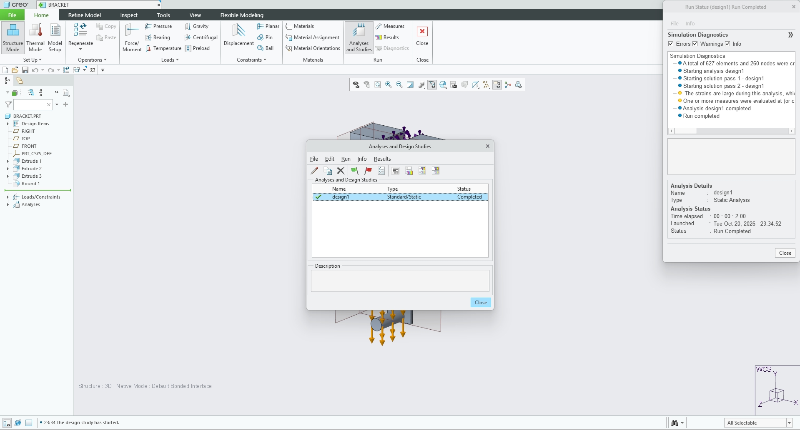
    <figcaption style="font-size: 0.85em; color: gray; margin-top: 5px;">
      Executing static analysis design study for Design I
    </figcaption>
  </figure>

---

## 3. Computation & Inner Loop Mesh Convergence

Each outer loop design was subjected to a 3-iteration inner loop mesh convergence study. Results were monitored to ensure solution stability and verify that maximum stress and global displacement stabilized within acceptable engineering tolerances.

### Inner Loop Convergence Summary
- **Design I (Baseline):** Default mesh yielded $627$ elements, establishing baseline static compliance ($\sigma_{\text{max}} = 1.090 \times 10^6\text{ psi}$ at root fillet; $\delta_{\text{max}} = 1.554\text{ in}$ at pin tip).
- **Design II (Horizontal Through-Holes):** Evaluated across default ($936$ elements), intermediate ($0.25\text{ in}$ control $\rightarrow$ $799$ elements), and fine ($0.125\text{ in}$ control $\rightarrow$ $1,518$ elements) meshes, converging on a max stress of $9.595 \times 10^5\text{ psi}$ and max deflection of $1.553\text{ in}$.
- **Design III (Pill-Shaped Slot Cut):** Evaluated across default ($936$ elements), intermediate ($0.25\text{ in}$ control $\rightarrow$ $1,545$ elements), and fine ($0.125\text{ in}$ control $\rightarrow$ $1,545$ elements) meshes, achieving final stabilized convergence at a max stress of $6.572 \times 10^5\text{ psi}$ and max deflection of $1.573\text{ in}$.

  <figure style="display: inline-block; margin: 10px; vertical-align: top;">
    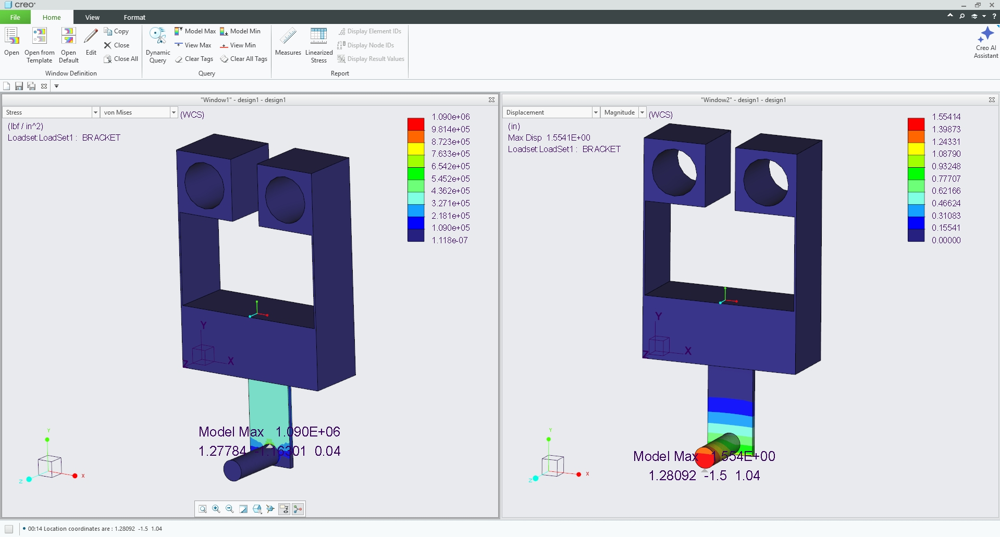
    <figcaption style="font-size: 0.85em; color: gray; margin-top: 5px;">
      Design I baseline stress and deflection results ($1.090 \times 10^6\text{ psi}$)
    </figcaption>
  </figure>
  <figure style="display: inline-block; margin: 10px; vertical-align: top;">
    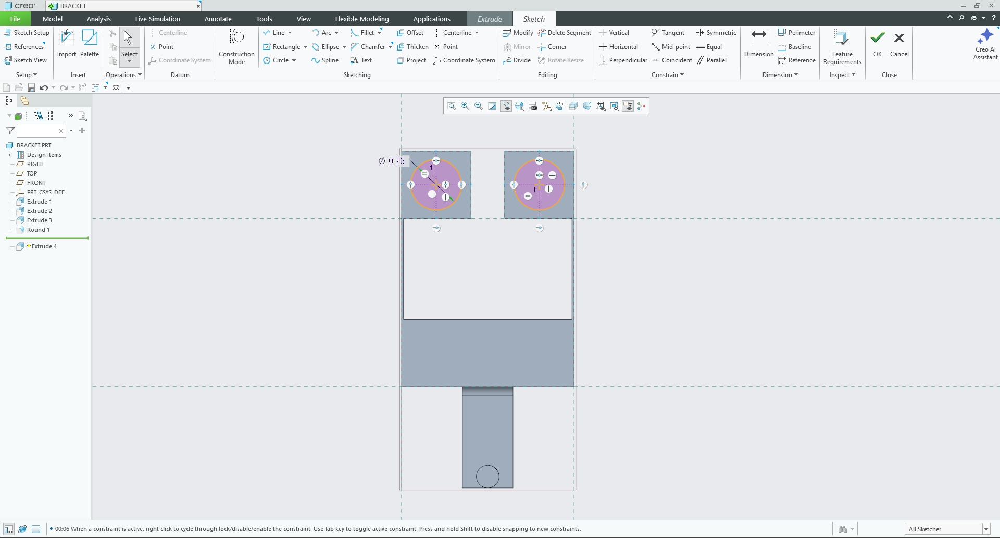
    <figcaption style="font-size: 0.85em; color: gray; margin-top: 5px;">
      Design II horizontal through-hole sketch ($\varnothing 0.75\text{ in}$)
    </figcaption>
  </figure>

  <figure style="display: inline-block; margin: 10px; vertical-align: top;">
    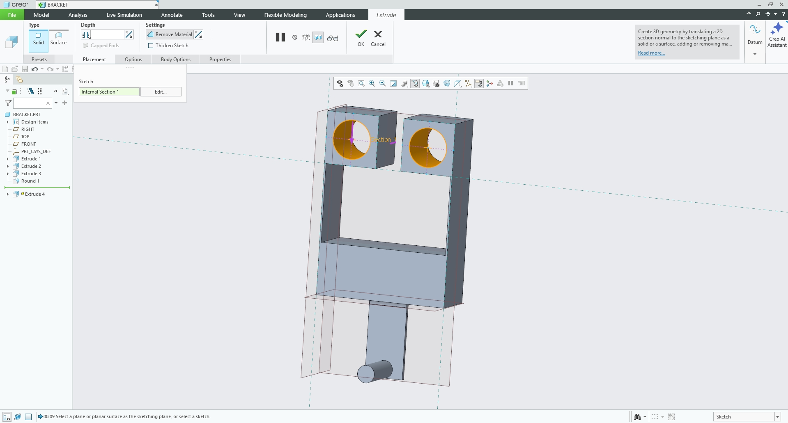
    <figcaption style="font-size: 0.85em; color: gray; margin-top: 5px;">
      Extruding upper parallel through-holes (Remove Material)
    </figcaption>
  </figure>
  <figure style="display: inline-block; margin: 10px; vertical-align: top;">
    
    <figcaption style="font-size: 0.85em; color: gray; margin-top: 5px;">
      Design II default AutoGEM mesh summary (936 elements)
    </figcaption>
  </figure>

  <figure style="display: inline-block; margin: 10px; vertical-align: top;">
    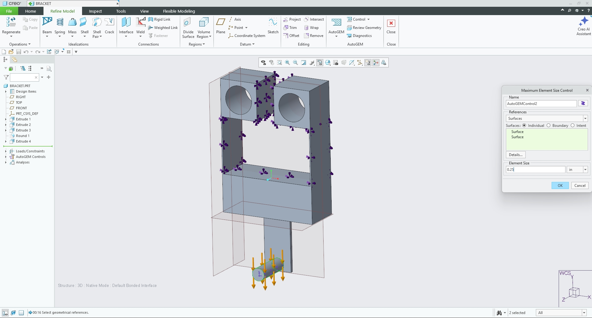
    <figcaption style="font-size: 0.85em; color: gray; margin-top: 5px;">
      Design II intermediate mesh size control ($0.25\text{ in}$)
    </figcaption>
  </figure>
  <figure style="display: inline-block; margin: 10px; vertical-align: top;">
    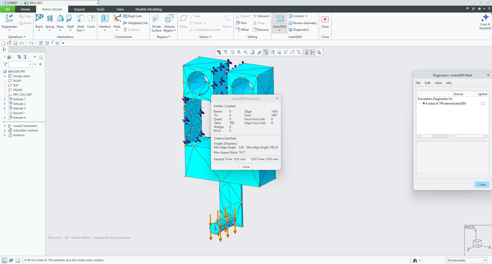
    <figcaption style="font-size: 0.85em; color: gray; margin-top: 5px;">
      Design II intermediate mesh summary (799 elements)
    </figcaption>
  </figure>

  <figure style="display: inline-block; margin: 10px; vertical-align: top;">
    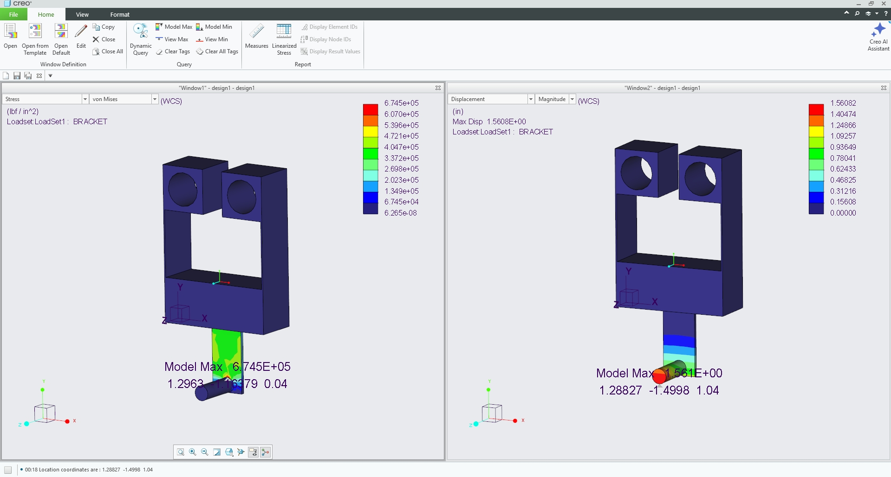
    <figcaption style="font-size: 0.85em; color: gray; margin-top: 5px;">
      Design II intermediate stress and deflection ($6.745 \times 10^5\text{ psi}$)
    </figcaption>
  </figure>
  <figure style="display: inline-block; margin: 10px; vertical-align: top;">
    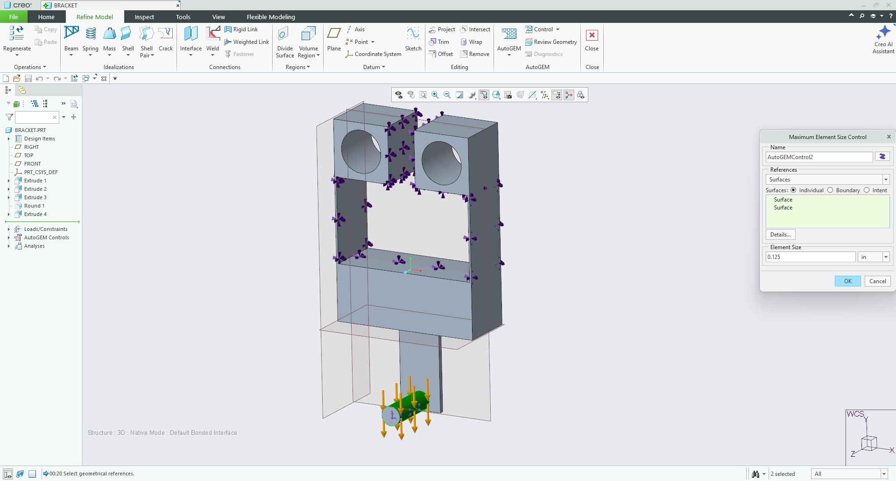
    <figcaption style="font-size: 0.85em; color: gray; margin-top: 5px;">
      Design II fine mesh size control setup ($0.125\text{ in}$)
    </figcaption>
  </figure>

  <figure style="display: inline-block; margin: 10px; vertical-align: top;">
    
    <figcaption style="font-size: 0.85em; color: gray; margin-top: 5px;">
      Design II fine mesh summary (1,518 elements)
    </figcaption>
  </figure>
  <figure style="display: inline-block; margin: 10px; vertical-align: top;">
    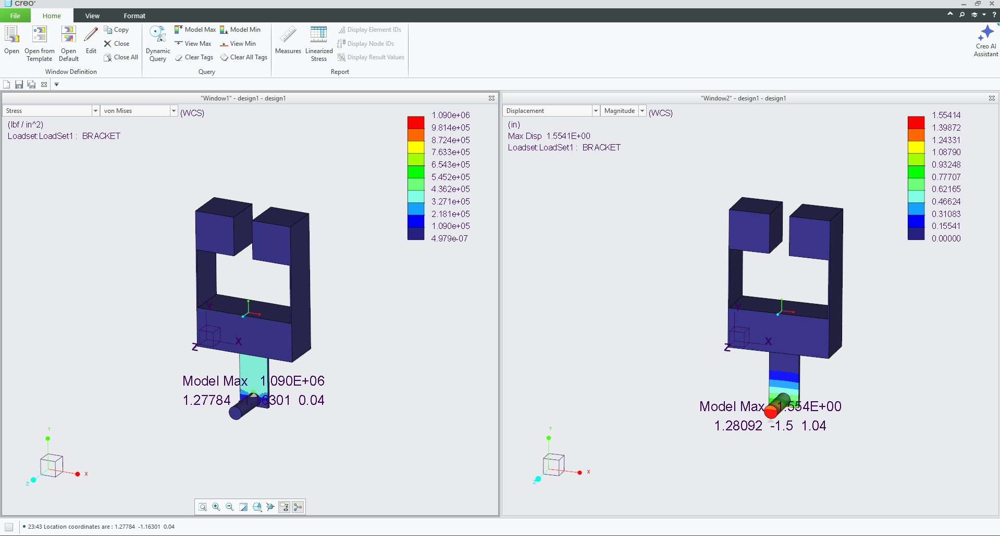
    <figcaption style="font-size: 0.85em; color: gray; margin-top: 5px;">
      Design II final converged results ($9.595 \times 10^5\text{ psi}$)
    </figcaption>
  </figure>

  <figure style="display: inline-block; margin: 10px; vertical-align: top;">
    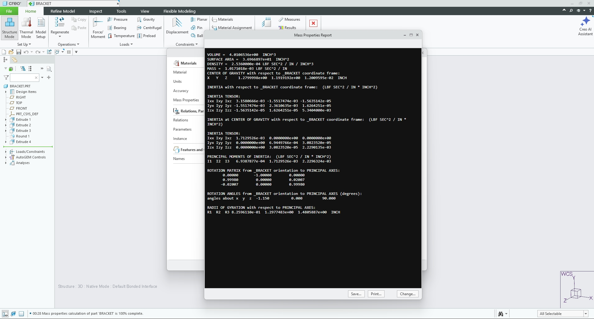
    <figcaption style="font-size: 0.85em; color: gray; margin-top: 5px;">
      Design II mass properties report ($0.3927\text{ lbf}$)
    </figcaption>
  </figure>
  <figure style="display: inline-block; margin: 10px; vertical-align: top;">
    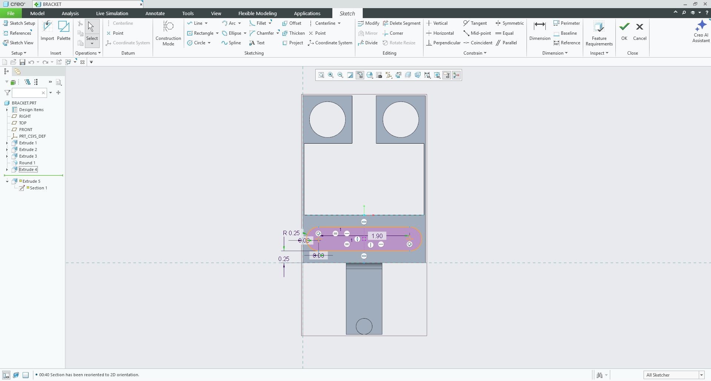
    <figcaption style="font-size: 0.85em; color: gray; margin-top: 5px;">
      Design III pill slot sketch dimensions ($1.90\text{ in} \times R0.25\text{ in}$)
    </figcaption>
  </figure>

  <figure style="display: inline-block; margin: 10px; vertical-align: top;">
    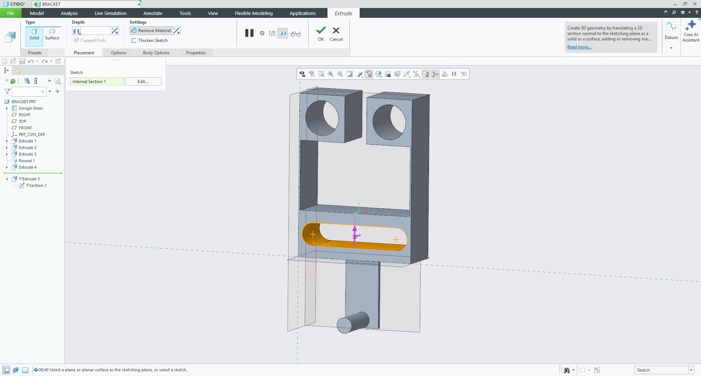
    <figcaption style="font-size: 0.85em; color: gray; margin-top: 5px;">
      Extruding central pill-shaped slot through lower web
    </figcaption>
  </figure>
  <figure style="display: inline-block; margin: 10px; vertical-align: top;">
    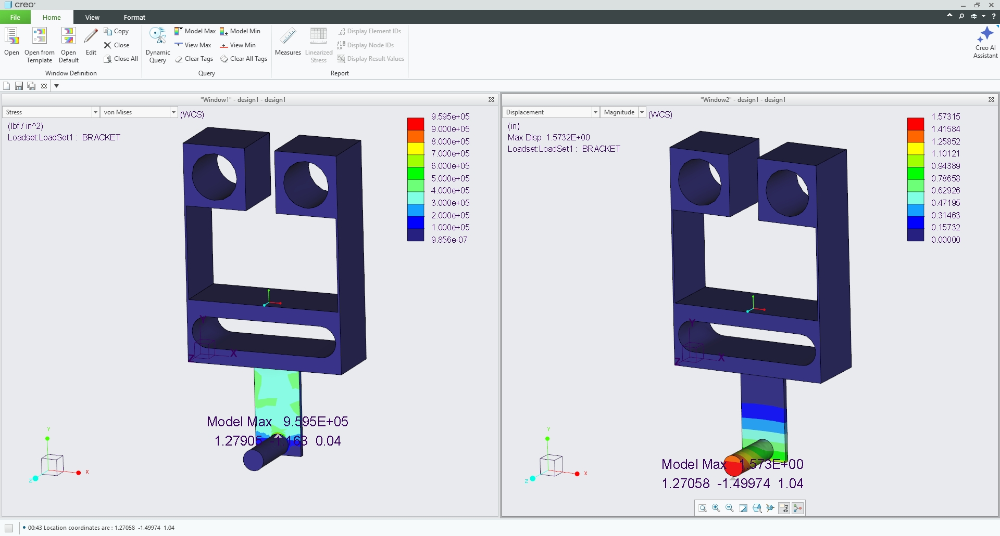
    <figcaption style="font-size: 0.85em; color: gray; margin-top: 5px;">
      Design III Iteration 1 results ($9.595 \times 10^5\text{ psi}$)
    </figcaption>
  </figure>

  <figure style="display: inline-block; margin: 10px; vertical-align: top;">
    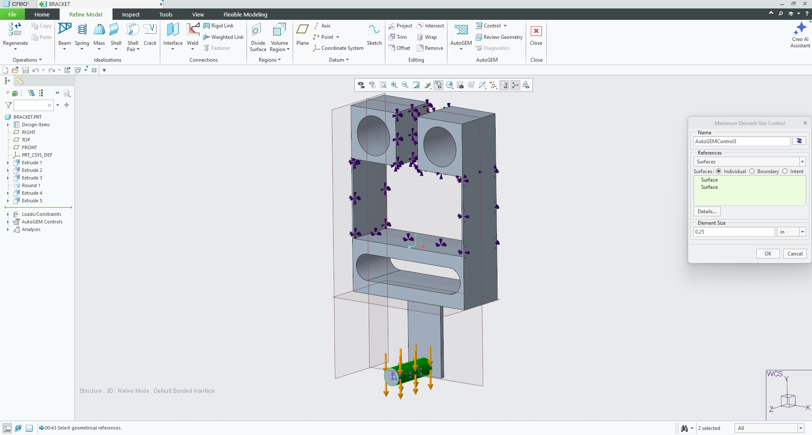
    <figcaption style="font-size: 0.85em; color: gray; margin-top: 5px;">
      Design III mesh size control setup for iteration runs
    </figcaption>
  </figure>
  <figure style="display: inline-block; margin: 10px; vertical-align: top;">
    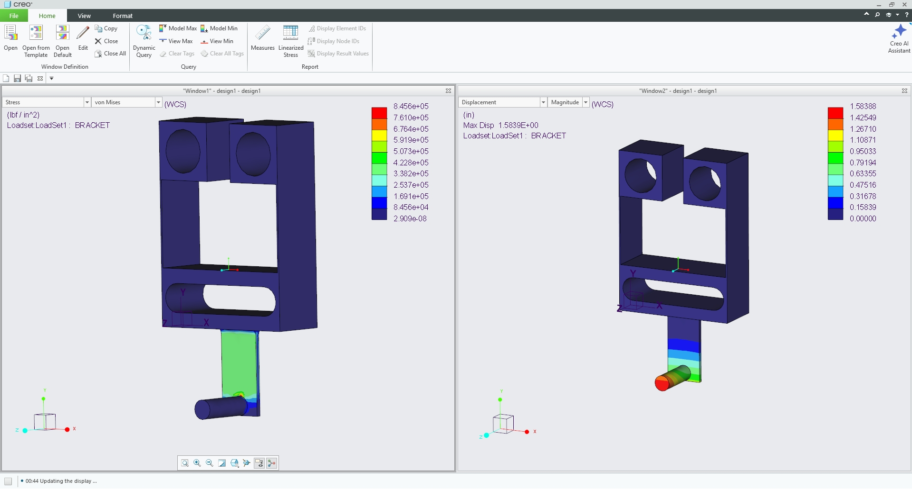
    <figcaption style="font-size: 0.85em; color: gray; margin-top: 5px;">
      Design III Iteration 2 results ($8.456 \times 10^5\text{ psi}$)
    </figcaption>
  </figure>

  <figure style="display: inline-block; margin: 10px; vertical-align: top;">
    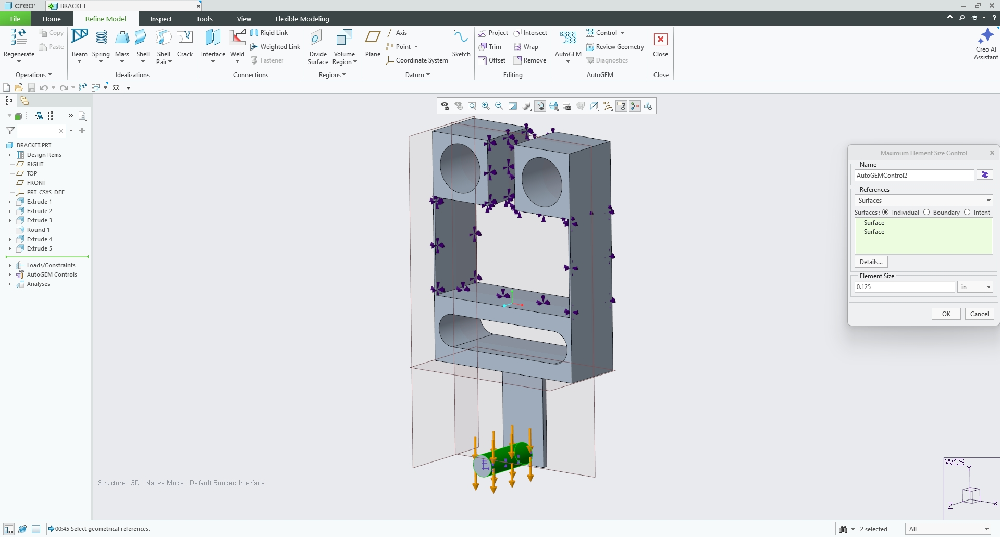
    <figcaption style="font-size: 0.85em; color: gray; margin-top: 5px;">
      Design III fine mesh control setup ($0.125\text{ in}$)
    </figcaption>
  </figure>
  <figure style="display: inline-block; margin: 10px; vertical-align: top;">
    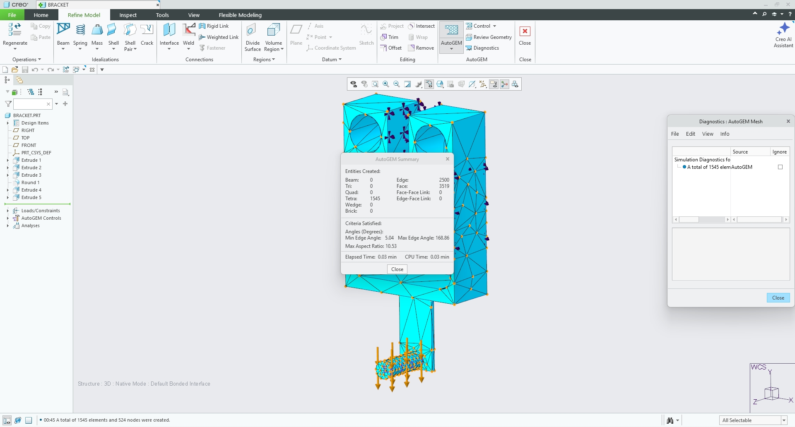
    <figcaption style="font-size: 0.85em; color: gray; margin-top: 5px;">
      Design III fine mesh summary (1,545 elements)
    </figcaption>
  </figure>

  <figure style="display: inline-block; margin: 10px; vertical-align: top;">
    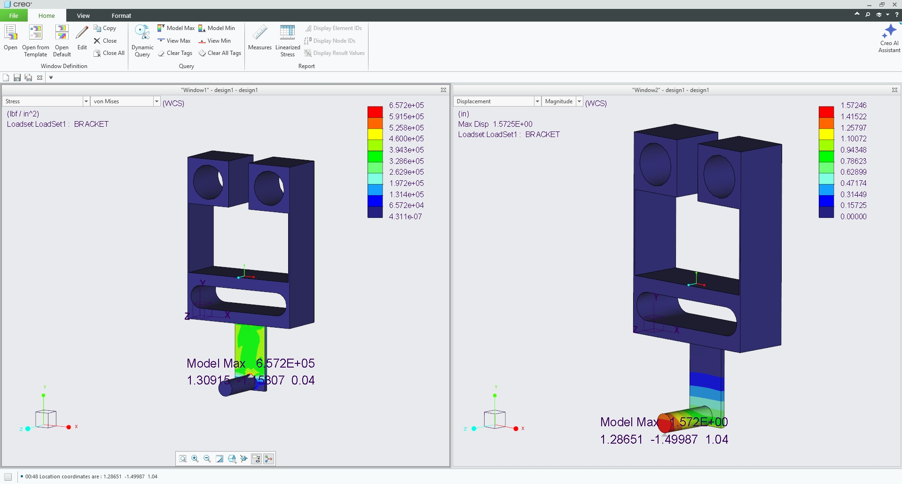
    <figcaption style="font-size: 0.85em; color: gray; margin-top: 5px;">
      Design III converged finest mesh stress ($6.572 \times 10^5\text{ psi}$)
    </figcaption>
  </figure>
  <figure style="display: inline-block; margin: 10px; vertical-align: top;">
    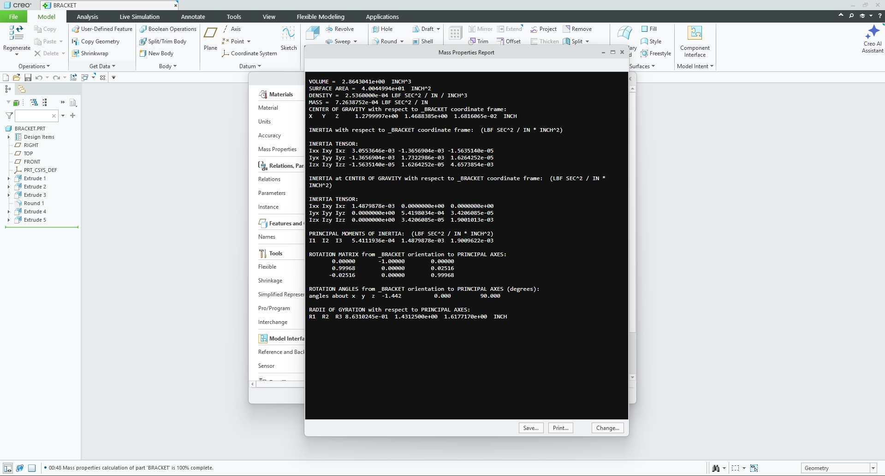
    <figcaption style="font-size: 0.85em; color: gray; margin-top: 5px;">
      Design III final mass properties report ($0.2804\text{ lbf}$)
    </figcaption>
  </figure>

---

## 4. Data Interpretation & Outer Loop Optimization Table

The master comparison table below compiles the converged finest-mesh results for all three outer loop iterations:

| Metric / Parameter | Design I (Baseline) | Design II (Horizontal Holes) | Design III (Pill Slot) |
| :--- | :--- | :--- | :--- |
| **Max Stress and Location** | $1.090 \times 10^6\text{ psi}$ *(Lower Root Fillet)* | $9.595 \times 10^5\text{ psi}$ *(Lower Root Fillet)* | $\mathbf{6.572 \times 10^5\text{ psi}}$ *(Lower Root Fillet)* |
| **Max Deflection and Location** | $1.554\text{ in}$ *(Loaded Pin Tip)* | $1.553\text{ in}$ *(Loaded Pin Tip)* | $\mathbf{1.573\text{ in}}$ *(Loaded Pin Tip)* |
| **Mass / Weight** | $0.4792\text{ lbf}$ ($1.241 \times 10^{-3}\text{ lbf}\cdot\text{s}^2/\text{in}$) | $0.3927\text{ lbf}$ ($1.017 \times 10^{-3}\text{ lbf}\cdot\text{s}^2/\text{in}$) | $\mathbf{0.2804\text{ lbf}}$ ($7.264 \times 10^{-4}\text{ lbf}\cdot\text{s}^2/\text{in}$) |
| **Safety Factor ($FS$)** | $0.0367$ | $0.0417$ | $\mathbf{0.0609}$ |
| **Number of Elements** | $627$ elements *(Default)* | $1,518$ elements *(Fine)* | $\mathbf{1,545}$ elements *(Fine)* |

---

## 5. Design Optimization & Performance Trade-Offs

1. **Design I to Design II Transition:** Extruding two parallel $\varnothing 0.75\text{ in}$ horizontal through-holes in the upper blocks reduced total bracket weight from $0.4792\text{ lbf}$ to $0.3927\text{ lbf}$, achieving an $\mathbf{18.05\%}$ mass reduction with negligible impact on global structural stiffness.
2. **Design II to Design III Transition:** Introducing a centralized pill-shaped slot ($\text{length } 1.90\text{ in}$, radius $R 0.25\text{ in}$) further reduced total weight to $0.2804\text{ lbf}$, achieving a cumulative $\mathbf{41.49\%}$ mass reduction relative to the baseline.
3. **Stress Mitigation:** The smooth semicircular ends of the pill slot in Design III effectively distributed bending load paths around the material removal zone, decreasing peak Von Mises stress at the root fillet by $\mathbf{31.5\%}$ ($9.595 \times 10^5\text{ psi} \rightarrow 6.572 \times 10^5\text{ psi}$).

---

## 6. Engineering Reflection & Lessons Learned

### Lessons Learned
- **Mesh Discretization & Convergence:** Finite element models exhibit mesh dependency near geometrical stress risers. Refining element size from coarse defaults down to $0.125\text{ in}$ allows the global stiffness matrix to reach numerical equilibrium, ensuring reliable and stable stress and displacement predictions.
- **Computational Expense vs. Resolution:** Increasing element density exponentially expands solver compute times. Applying targeted local mesh controls strictly around high-stress fillets and cutout perimeters optimizes computational efficiency without sacrificing precision.
- **Geometric Stress Concentration Avoidance:** Sharp interior corners create severe stress concentrations and artificial singularities. Incorporating smooth circular radii and pill-shaped slots preserves structural integrity while enabling substantial weight reduction.
- **Stiffness vs. Mass Optimization:** Material removal near neutral axes and lower-stressed zones minimizes structural compliance penalties while maximizing mass efficiency. Design III successfully balanced this trade-off by achieving a $41.49\%$ mass reduction with minimal global deflection change.

### Documented Time Spent Log
- **CAD Modeling & Feature Adjustments:** 2.5 hours
- **FEA Setup, Preprocessing & Solver Execution:** 3.5 hours
- **Data Logging & Mesh Convergence Calculations:** 1.5 hours
- **Report Assembly & Portfolio Integration:** 1.5 hours
- **Actual Total Time (Start to Finish):** **9.0 hours**

  <!-- CAD Part Files Download Button -->
  <a href="design1-3.zip" download="design1-3.zip" style="
    background-color: #1976d2; 
    color: white; 
    text-decoration: none;
    padding: 12px 22px; 
    font-size: 0.95em; 
    font-weight: bold; 
    border-radius: 5px; 
    box-shadow: 0 2px 5px rgba(0,0,0,0.15);
    display: inline-block;
    transition: background-color 0.2s;">
    📦 Download CAD Part Files (Design I, II, III)
  </a>

## Resources

All design, simulation, and documentation work was completed using:

<ul style="list-style-type: circle !important; padding-left: 20px;">
  <li style="list-style-type: circle !important; margin-bottom: 4px;">
    PTC Creo Parametric & Creo Simulate
  </li>
  <li style="list-style-type: circle !important; margin-bottom: 4px;">
    Understanding the Finite Element Method - The Efficient Engineer
  </li>
  <li style="list-style-type: circle !important; margin-bottom: 4px;">
    Machinery's Handbook (Standard Structural Design & Material Properties)
  </li>
</ul>

  
