# A8: Gearbox Design

<small>***(Clicking on the images will enlarge them)***</small>

## 1. Documentation & Intent

The goal for this assignment was to design, model, and assemble a 24:9 spur gearbox from scratch while working through all the geometric clashes, bearing stack-ups, and tolerance issues that pop up al[...]

### Design Thought Process & Insights
- **The Pocket Sizing Fix:** When I first cut the internal housing cavity, I made the mistake of sizing the pockets using the pitch diameters. That caused the gear teeth tips ($OD$) to smash right int[...]
- **Figuring Out the Bearings:** Getting the bronze sleeve bearings right took some careful planning. The shorter input bearings (`6391K326`, $0.156\text{ in}$ long) sit completely hidden and flush in[...]
- **Enclosure Fasteners:** To clamp the housing halves together securely, I set up the top block with #4 clearance holes ($\varnothing 0.128\text{ in}$) and counterbores so the screw heads sit flush, [...]

  <figure style="display: inline-block; margin: 10px; vertical-align: top;">
    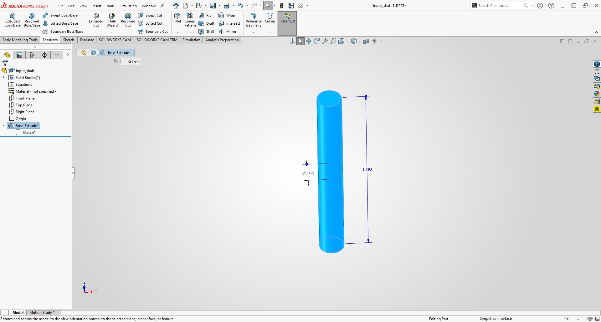
    <figcaption style="font-size: 0.85em; color: gray; margin-top: 5px;">
      Modeling the input shaft and adding $0.015\text{ in} \times 45^\circ$ end chamfers
    </figcaption>
  </figure>
  <figure style="display: inline-block; margin: 10px; vertical-align: top;">
    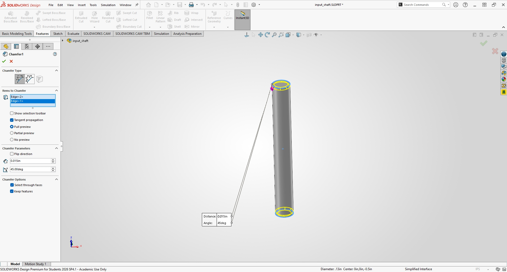
    <figcaption style="font-size: 0.85em; color: gray; margin-top: 5px;">
      Checking the chamfer property manager settings
    </figcaption>
  </figure>

  <figure style="display: inline-block; margin: 10px; vertical-align: top;">
    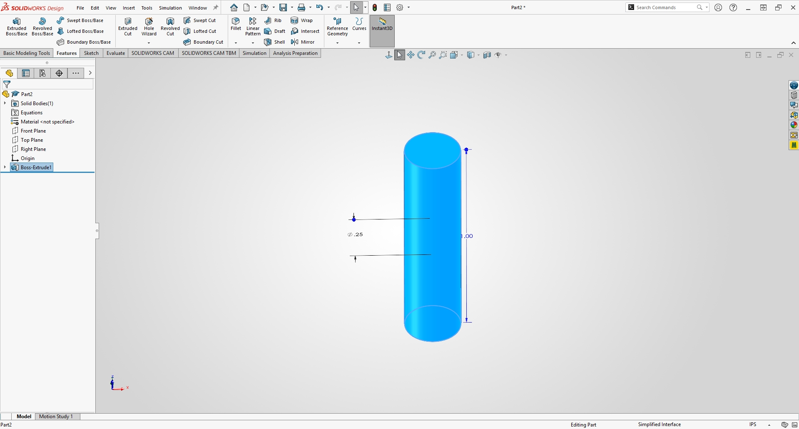
    <figcaption style="font-size: 0.85em; color: gray; margin-top: 5px;">
      Setting up the output shaft geometry ($\varnothing 0.250\text{ in} \times 1.000\text{ in}$)
    </figcaption>
  </figure>
  <figure style="display: inline-block; margin: 10px; vertical-align: top;">
    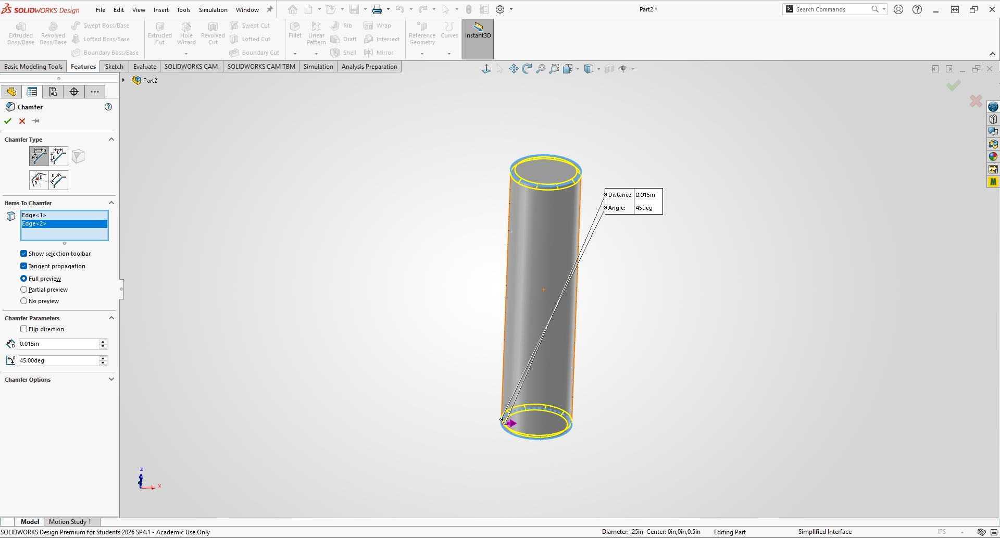
    <figcaption style="font-size: 0.85em; color: gray; margin-top: 5px;">
      Applying end chamfers to the output shaft
    </figcaption>
  </figure>

  <figure style="display: inline-block; margin: 10px; vertical-align: top;">
    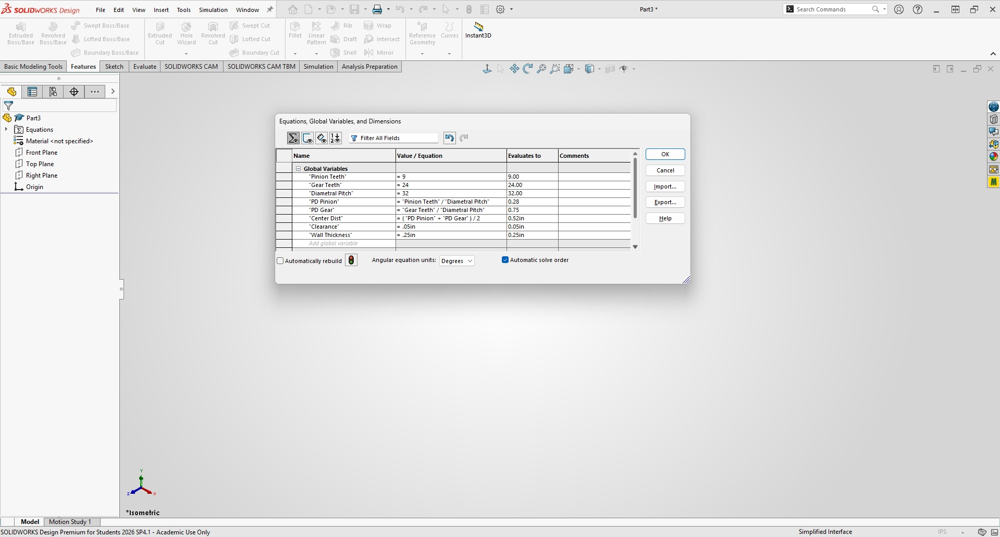
    <figcaption style="font-size: 0.85em; color: gray; margin-top: 5px;">
      Setting up the global variables table for gear kinematics and center distance
    </figcaption>
  </figure>
  <figure style="display: inline-block; margin: 10px; vertical-align: top;">
    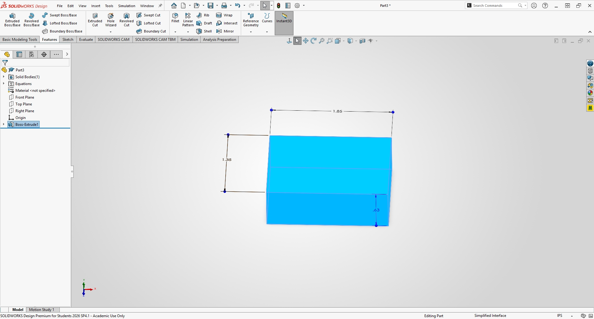
    <figcaption style="font-size: 0.85em; color: gray; margin-top: 5px;">
      Laying out the baseline housing block dimensions ($1.850\text{ in} \times 1.350\text{ in}$)
    </figcaption>
  </figure>

---

## 2. Mathematical Modeling & Parametric Equations

To keep everything parametric and linked together, I set up global variables in SolidWorks based on standard spur gear formulas:

1. **Gear Ratio:** $24:9$ (2.67:1 speed reduction)
2. **Diametral Pitch ($P_d$):** $32\text{ in}^{-1}$ ($20^\circ$ pressure angle)
3. **Pitch Diameters ($D$):**
   $$D_{\text{pinion}} = \frac{N_1}{P_d} = \frac{9}{32} = 0.28125\text{ in}$$
   $$D_{\text{gear}} = \frac{N_2}{P_d} = \frac{24}{32} = 0.75000\text{ in}$$
4. **Center-to-Center Distance ($C$):**
   $$C = \frac{D_{\text{pinion}} + D_{\text{gear}}}{2} = \frac{0.28125 + 0.75000}{2} = \mathbf{0.515625}\text{ in}$$
5. **Outside Diameters ($OD$) & Pocket Sizing ($c = 0.050\text{ in}$):**
   $$OD_{\text{pinion}} = \frac{N_1 + 2}{P_d} = \frac{9 + 2}{32} = 0.34375\text{ in} \;\Rightarrow\; \text{Pocket Dia}_{1} = OD_{\text{pinion}} + 2c = 0.34375 + 2(0.050) = \mathbf{0.44375}\text{ in}$$
   $$OD_{\text{gear}} = \frac{N_2 + 2}{P_d} = \frac{24 + 2}{32} = 0.81250\text{ in} \;\Rightarrow\; \text{Pocket Dia}_{2} = OD_{\text{gear}} + 2c = 0.81250 + 2(0.050) = \mathbf{0.91250}\text{ in}$$
   

  <figure style="display: inline-block; margin: 10px; vertical-align: top;">
    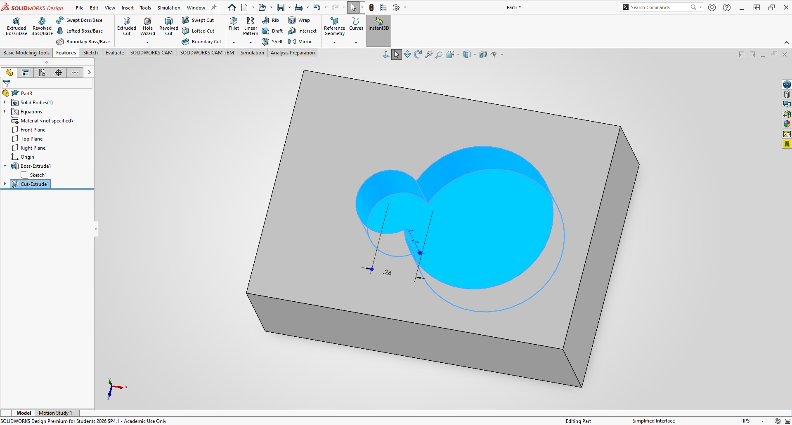
    <figcaption style="font-size: 0.85em; color: gray; margin-top: 5px;">
      Cutting the corrected housing pockets using the new OD dimensions
    </figcaption>
  </figure>
  <figure style="display: inline-block; margin: 10px; vertical-align: top;">
    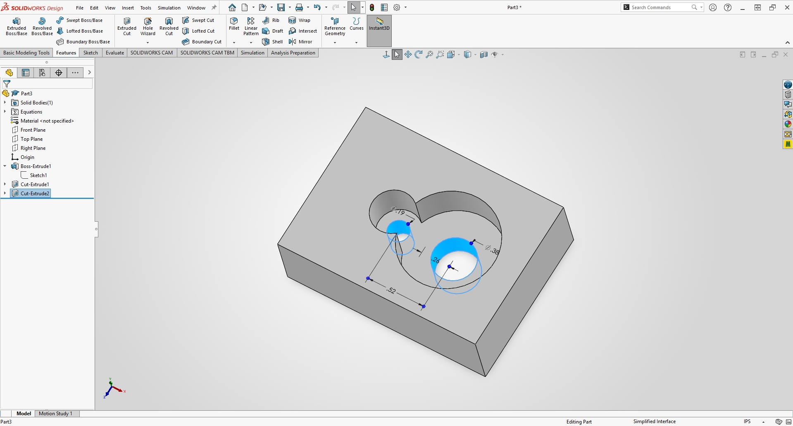
    <figcaption style="font-size: 0.85em; color: gray; margin-top: 5px;">
      Adding the internal bearing counterbores and through-bores
    </figcaption>
  </figure>

  <figure style="display: inline-block; margin: 10px; vertical-align: top;">
    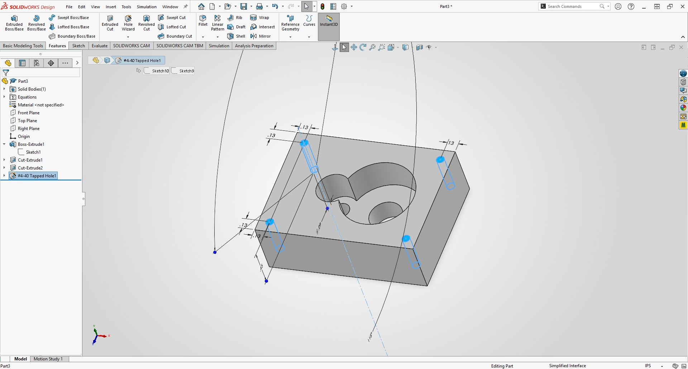
    <figcaption style="font-size: 0.85em; color: gray; margin-top: 5px;">
      Adding the #4-40 blind tapped holes to the lower housing base
    </figcaption>
  </figure>
  <figure style="display: inline-block; margin: 10px; vertical-align: top;">
    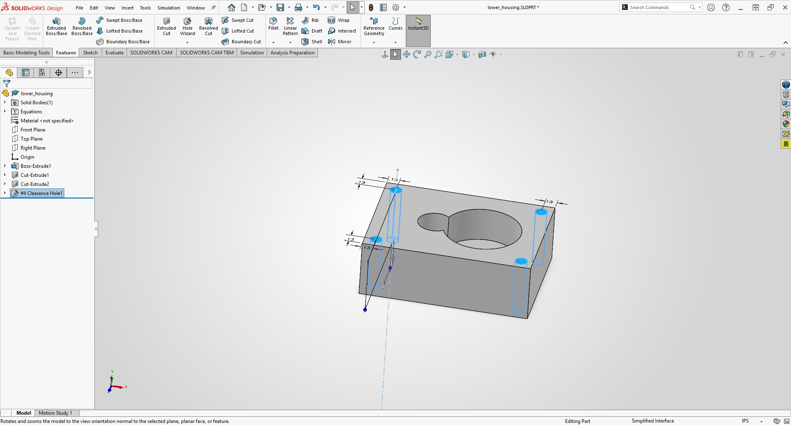
    <figcaption style="font-size: 0.85em; color: gray; margin-top: 5px;">
      Configuring the #4 clearance holes and counterbores on the upper housing
    </figcaption>
  </figure>

---

## 3. Component Specification & Interface Table

Here is the quick reference breakdown for all the hardware and housing parts used in the assembly:

| Component / Subsystem | Part Number / Type | Critical Dimensions | Housing Interface | Placement / Alignment Strategy |
| :--- | :--- | :--- | :--- | :--- |
| **Upper Housing** | Custom Machined / Molded | $1.850\text{ in} \times 1.350\text{ in} \times 0.625\text{ in}$ | Top Split Enclosure | #4 Clearance holes ($\varnothing 0.128\text{ in}$) with $\varno[...]
| **Lower Housing** | Custom Machined / Molded | $1.850\text{ in} \times 1.350\text{ in} \times 0.625\text{ in}$ | Bottom Split Base | #4-40 Blind Tapped holes ($0.375\text{ in}$ thread, $0.450\text{ [...]
| **Input Shaft & Pinion** | Steel / McMaster | $\varnothing 0.125\text{ in} \times 1.000\text{ in}$ ($9\text{T}$, $32P_d$) | `6391K326` Bearings | Concentric to input bore, centered inside $0.750\tex[...]
| **Output Shaft & Gear** | Steel / McMaster | $\varnothing 0.250\text{ in} \times 1.000\text{ in}$ ($24\text{T}$, $32P_d$) | `6391K132` Bearings | Concentric to output bore, centered at $0.515625\tex[...]
| **Short Input Bearings** | McMaster `#6391K326` | $0.125\text{ in ID} \times 0.1875\text{ in OD} \times 0.156\text{ in L}$ | Blind Counterbore | Seated flush inside $0.156\text{ in}$ deep housing fl[...]
| **Long Output Bearings** | McMaster `#6391K132` | $0.250\text{ in ID} \times 0.3750\text{ in OD} \times 0.500\text{ in L}$ | Through-Bore | Centered with $0.125\text{ in}$ distance mate to exterior [...]

---

## 4. Technical Troubleshooting & SolidWorks Assembly Validation

Putting the assembly together started off straightforward by anchoring the lower housing, dropping in the bearings, and lining up the shafts. But by the end of the final assembly sequence, things got [...]

### Assembly Steps & Crash Walkthrough
- **Starting Out:** I anchored the lower housing (`lower_housing<1>`) at the origin to keep everything grounded.
- **Adding the Bearings:** I mated the bearing outer diameters concentrically to the housing holes, and used a $0.125\text{ in}$ distance mate to get the long output bearings centered nicely.
- **Where It Fell Apart:** By the very end of the assembly process, trying to rebuild with all the parts fully mated caused SolidWorks to crash repeatedly. The solver got stuck in cyclic loops trying [...]

  <figure style="display: inline-block; margin: 10px; vertical-align: top;">
    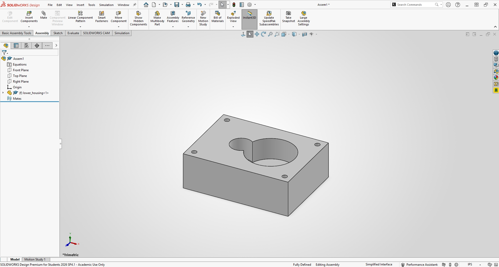
    <figcaption style="font-size: 0.85em; color: gray; margin-top: 5px;">
      Starting the assembly workspace with the lower housing fixed in place
    </figcaption>
  </figure>
  <figure style="display: inline-block; margin: 10px; vertical-align: top;">
    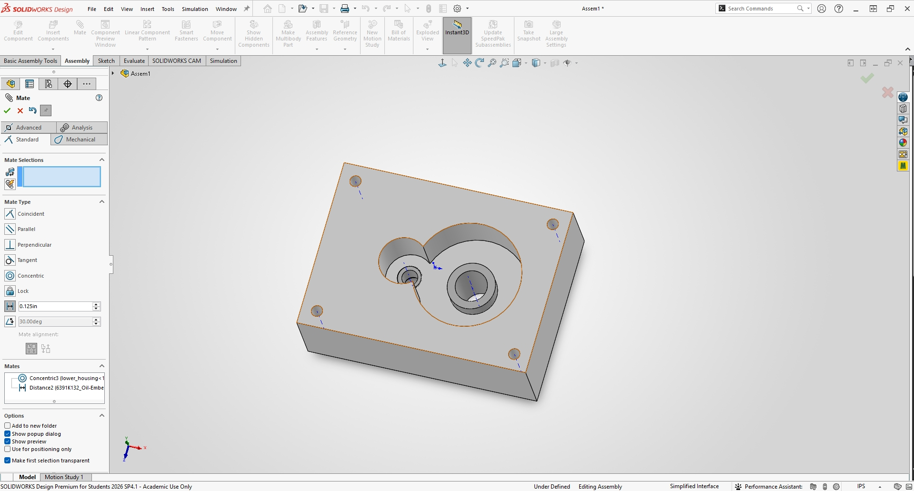
    <figcaption style="font-size: 0.85em; color: gray; margin-top: 5px;">
      Wrapping up the bearing mates right before SolidWorks crashed at the end of assembly
    </figcaption>
  </figure>

---

## 5. Engineering Reflection & Lessons Learned

### What I Learned
- **Watch Out for Pocket Clearances:** Sizing cavities using pitch diameters is a classic trap. Always use the Outside Diameters ($OD = \frac{N+2}{P_d}$) plus your clearance buffer so your gear teeth [...]
- **Handle Long Bearings Carefully:** When a bushing is longer than your housing wall, don't rely on random face coincidences. Use explicit distance mates so it pokes out evenly on both sides.
- **Expect CAD Software Crashes:** Complex supplier STEP files can completely break your mate solver by the end of an assembly. Simplifying models or locking down references earlier can save you [...]

### Time Spent Working on This Project
- **Mathematical Modeling & Pocket Calculations:** 2.0 hours
- **CAD Part Modeling & Feature Updates:** 3.0 hours
- **Assembly Mating & Bearing Stack-Up:** 2.5 hours
- **Troubleshooting Crashes & Fixing Errors:** 2.0 hours
- **Formatting the Portfolio & Organizing Screenshots:** 1.5 hours
- **Total Time Invested:** **11.0 hours**

  <!-- Master Download Button for All Assets -->
  <a href="A8.zip" download="A8.zip" style="
    background-color: #1976d2; 
    color: white; 
    text-decoration: none;
    padding: 12px 22px; 
    font-size: 0.95em; 
    font-weight: bold; 
    border-radius: 5px; 
    box-shadow: 0 2px 5px rgba(0,0,0,0.15);
    display: inline-block;
    transition: background-color 0.2s;">
    📦 Download All Gearbox CAD Files & Screenshots (.zip)
  </a>

## Resources

References and tools used throughout this project:

<ul style="list-style-type: circle !important; padding-left: 20px;">
  <li style="list-style-type: circle !important; margin-bottom: 4px;">
    SolidWorks Academic Edition
  </li>
  <li style="list-style-type: circle !important; margin-bottom: 4px;">
    McMaster-Carr Online CAD Library
  </li>
  <li style="list-style-type: circle !important; margin-bottom: 4px;">
    Shigley's Mechanical Engineering Design (Gear & Tolerance Reference)
  </li>
</ul>

  
