# A9: Pulley System Design

<small>***(Clicking on the images will enlarge them)***</small>

## 1. Documentation & Intent

The goal for this assignment was to design, model, and assemble a 1:1 pulley drive system from scratch, working through belt tension calculations, component sizing, bearing stack-ups, and direct SolidWorks modeling workflows. 

### Design Thought Process & Insights
- **The Pulley Revolve Strategy:** Rather than sketching a solid block and cutting a hole, the pulley was modeled via a direct 2D sketch positioned above the centerline with an open inner bore gap, allowing a single $360^\circ$ revolve feature to simultaneously generate the solid body, shaft bore, and custom U-groove.
- **Journal Bearing Integration:** Using a single aluminum support frame plate ($0.500\text{ in}$ thick) meant housing two oil-impregnated sintered bronze journal bearings ($\varnothing 0.375\text{ in OD} \times 0.500\text{ in L}$) that sit completely flush on both the front and back faces without protruding awkwardly.
- **Shaft Length & Overhang Control:** To avoid excessive cantilever bending stress under operating belt tension ($F_1 = 7.5\text{ lbf}$), the shafts were sized to $1.500\text{ inches}$ in length, providing robust engagement through the $0.500\text{-inch}$ frame while maintaining precise coplanar pulley alignment on the front face.

  <figure style="display: inline-block; margin: 10px; vertical-align: top;">
    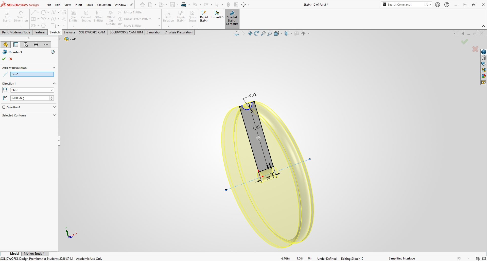
    <figcaption style="font-size: 0.85em; color: gray; margin-top: 5px;">
      Sketching the pulley profile above the centerline with the $0.1235\text{ in}$ U-groove radius
    </figcaption>
  </figure>
  <figure style="display: inline-block; margin: 10px; vertical-align: top;">
    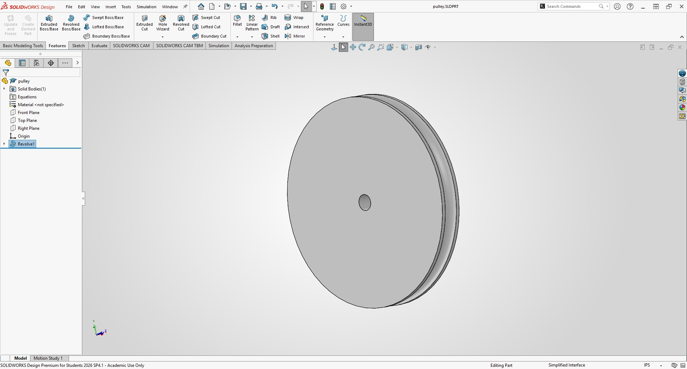
    <figcaption style="font-size: 0.85em; color: gray; margin-top: 5px;">
      Executing the $360^\circ$ revolved boss/base feature for the pulley
    </figcaption>
  </figure>

  <figure style="display: inline-block; margin: 10px; vertical-align: top;">
    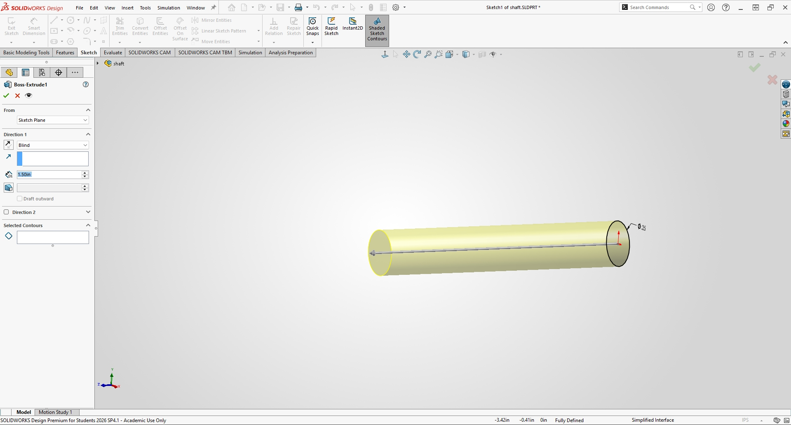
    <figcaption style="font-size: 0.85em; color: gray; margin-top: 5px;">
      Extruding the $\varnothing 0.250\text{ in} \times 1.500\text{ in}$ drive/driven shaft
    </figcaption>
  </figure>
  <figure style="display: inline-block; margin: 10px; vertical-align: top;">
    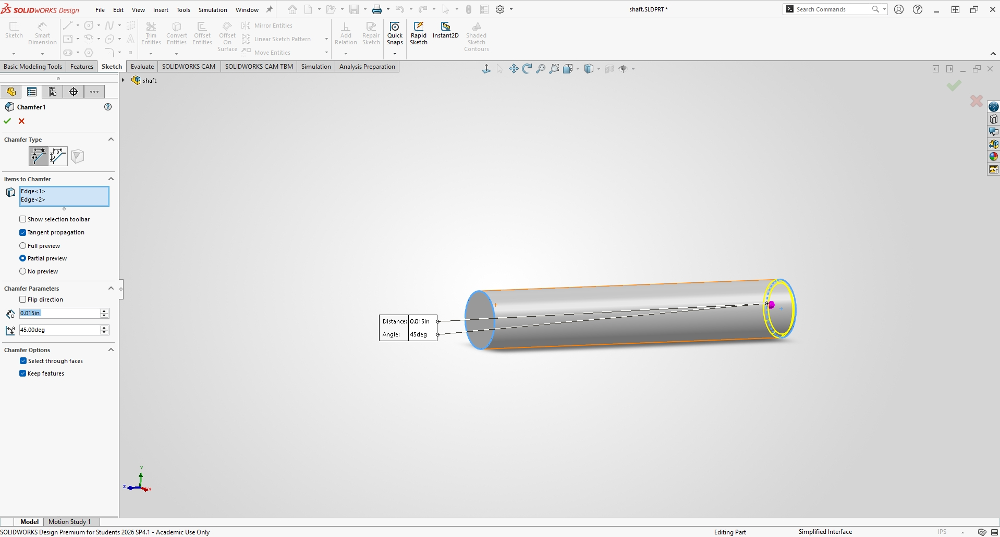
    <figcaption style="font-size: 0.85em; color: gray; margin-top: 5px;">
      Applying $0.015\text{ in} \times 45^\circ$ end chamfers to both ends of the shaft
    </figcaption>
  </figure>

  <figure style="display: inline-block; margin: 10px; vertical-align: top;">
    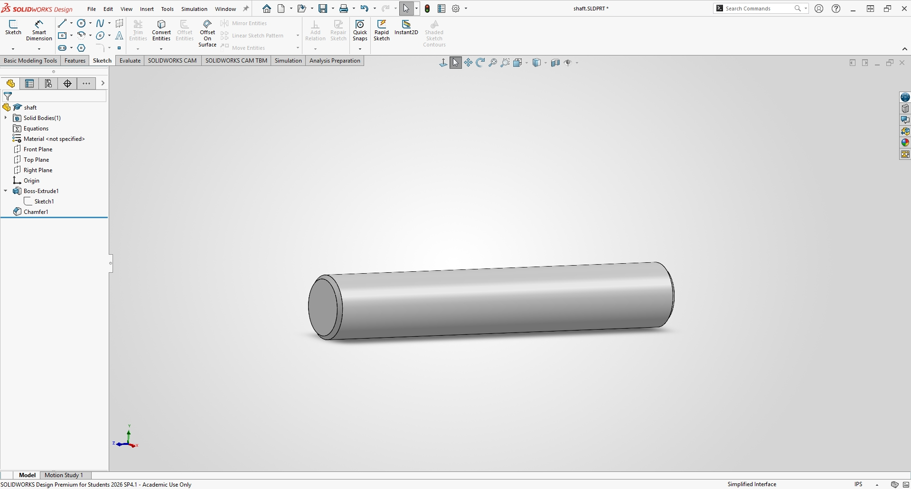
    <figcaption style="font-size: 0.85em; color: gray; margin-top: 5px;">
      Completed 1060 hardened steel shaft model ready for assembly
    </figcaption>
  </figure>
  <figure style="display: inline-block; margin: 10px; vertical-align: top;">
    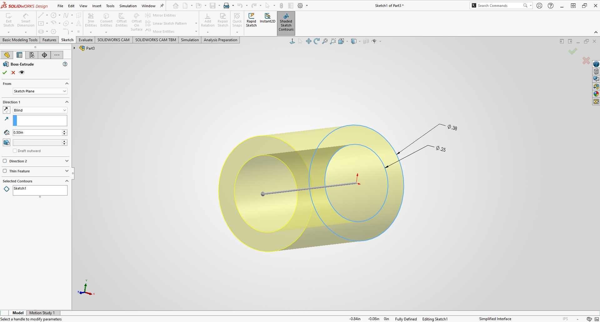
    <figcaption style="font-size: 0.85em; color: gray; margin-top: 5px;">
      Setting up the $0.250\text{ in ID}$ and $0.375\text{ in OD}$ journal bearing profile
    </figcaption>
  </figure>

---

## 2. Mathematical Modeling & Parametric Equations

To ensure proper belt engagement and prevent slip, analytical calculations were performed based on mechanical engineering standards:

1. **Operating Parameters:** $1:1$ speed ratio, $1500\text{ rpm}$, $5.000\text{ in}$ center distance ($C$).
2. **Belt Tension & Normal Stress ($F_1 = 7.5\text{ lbf}$, $\sigma_{\text{allow}} = 157\text{ psi}$):**
   $$A_{\text{belt}} = \frac{F_1}{\sigma_{\text{allow}}} = \frac{7.500\text{ lbf}}{157\text{ psi}} = \mathbf{0.04777}\text{ in}^2$$
3. **Belt Diameter ($d_{\text{belt}}$):**
   $$d_{\text{belt}} = \sqrt{\frac{4 A_{\text{belt}}}{\pi}} = \sqrt{\frac{4(0.04777)}{\pi}} = \mathbf{0.2466}\text{ in} \approx 0.247\text{ in}$$
4. **Pulley U-Groove Radius ($R_{\text{groove}}$):**
   $$R_{\text{groove}} = \frac{d_{\text{belt}}}{2} = \frac{0.2466\text{ in}}{2} = \mathbf{0.1235}\text{ in}$$
5. **Support Frame Geometry:** Center-to-center distance $C = 5.000\text{ in}$, overall plate length $6.250\text{ in}$, width $1.250\text{ in}$, and thickness $0.500\text{ in}$.

  <figure style="display: inline-block; margin: 10px; vertical-align: top;">
    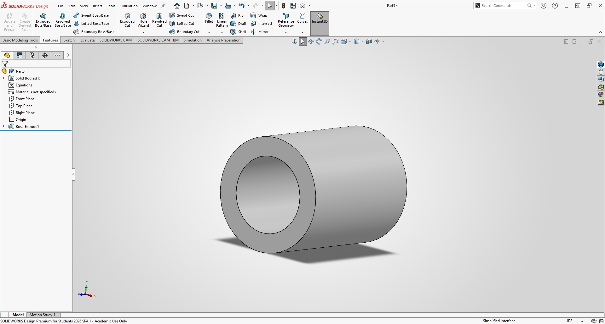
    <figcaption style="font-size: 0.85em; color: gray; margin-top: 5px;">
      Sintered bronze journal bearing part model ($\varnothing 0.375\text{ in OD} \times 0.500\text{ in L}$)
    </figcaption>
  </figure>
  <figure style="display: inline-block; margin: 10px; vertical-align: top;">
    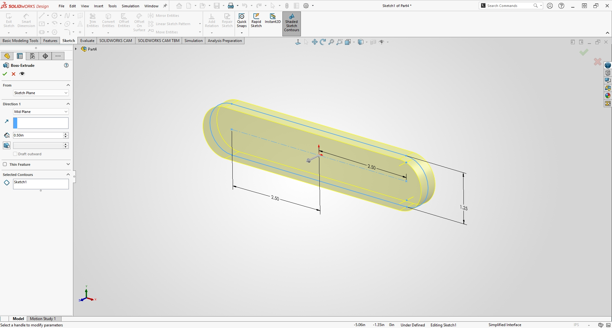
    <figcaption style="font-size: 0.85em; color: gray; margin-top: 5px;">
      Laying out the $5.000\text{ in}$ center-to-center pill-shaped support frame sketch
    </figcaption>
  </figure>

  <figure style="display: inline-block; margin: 10px; vertical-align: top;">
    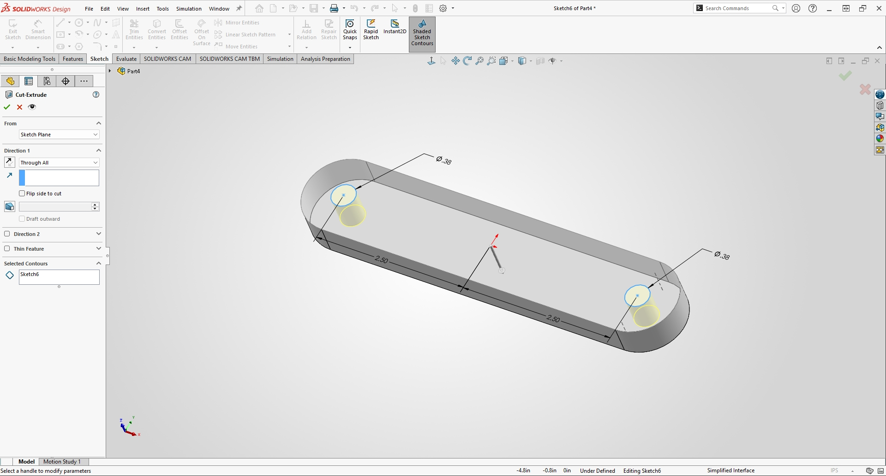
    <figcaption style="font-size: 0.85em; color: gray; margin-top: 5px;">
      Cutting the $\varnothing 0.375\text{ in}$ housing through-bores into the support plate
    </figcaption>
  </figure>
  <figure style="display: inline-block; margin: 10px; vertical-align: top;">
    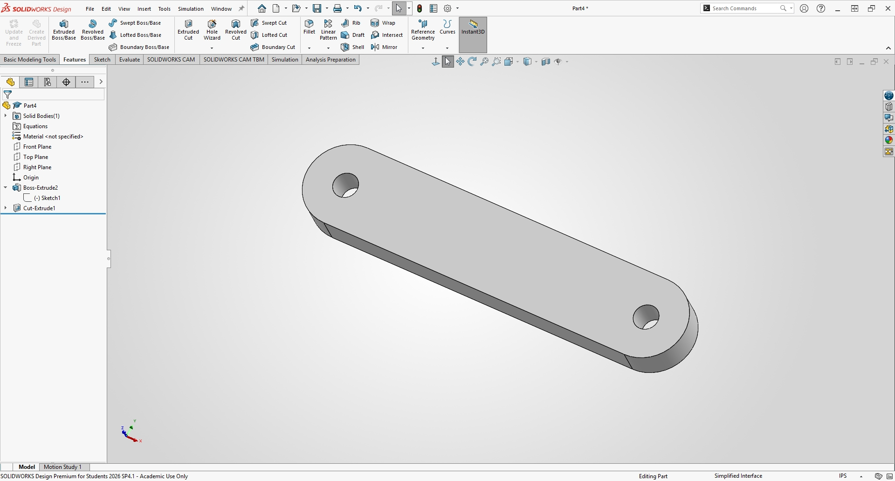
    <figcaption style="font-size: 0.85em; color: gray; margin-top: 5px;">
      Final machined 6061-T6 aluminum support frame model (`support_frame.sldprt`)
    </figcaption>
  </figure>

---

## 3. Component Specification & Interface Table

Here is the quick reference breakdown for all the hardware and structural parts used in the assembly:

| Component / Subsystem | Part Number / Type | Critical Dimensions | Housing Interface | Placement / Alignment Strategy |
| :--- | :--- | :--- | :--- | :--- |
| **Support Frame** | Custom Machined Plate | $6.250\text{ in L} \times 1.250\text{ in W} \times 0.500\text{ in T}$ | Structural Base | Grounded at origin; houses 2 journal bearings |
| **Journal Bearings** | McMaster Sintered Bronze | $\varnothing 0.250\text{ in ID} \times \varnothing 0.375\text{ in OD} \times 0.500\text{ in L}$ | Housing Through-Bores | Concentric to bores, flush on front and back faces |
| **Drive / Driven Shafts** | 1060 Hardened Steel | $\varnothing 0.250\text{ in} \times 1.500\text{ in L}$ | Journal Bearing ID | Concentric to bearings, $1.0\text{ in}$ front extension |
| **Pulleys** | Aluminum 6061-T6 | $\varnothing 3.000\text{ in OD} \times \varnothing 0.250\text{ in ID} \times 0.750\text{ in W}$ | Shaft Mount | Concentric to shafts, coplanar U-groove alignment |

---

## 4. Technical Troubleshooting & SolidWorks Assembly Validation

Assembling the pulley system required careful management of mates to ensure smooth kinematic motion without over-constraining the solver.

### Assembly Steps & Mating Strategy
- **Grounding the Frame:** Inserted `support_frame.sldprt` first and anchored it at the origin.
- **Installing Bearings:** Added 2 journal bearings, applying **Concentric** mates to the housing bores and **Coincident** mates to seat them flush against the frame faces.
- **Mounting Shafts:** Slid in both shafts using **Concentric** mates inside the bearings and established **Coincident** mates from their back faces to maintain a clean $1.0\text{ in}$ protrusion.
- **Aligning Pulleys:** Mounted the two pulleys on the front extension, locking them concentrically and aligning their U-grooves in a shared vertical plane.

  <figure style="display: inline-block; margin: 10px; vertical-align: top;">
    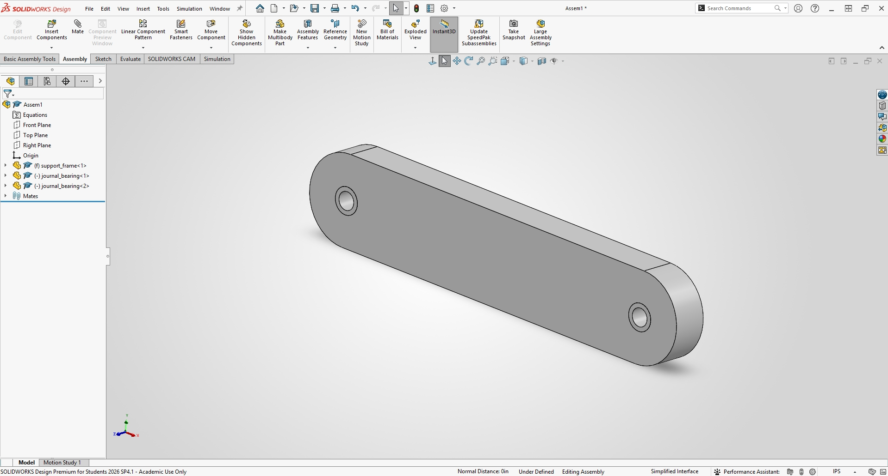
    <figcaption style="font-size: 0.85em; color: gray; margin-top: 5px;">
      Initializing the assembly workspace with the support frame fixed in place
    </figcaption>
  </figure>
  <figure style="display: inline-block; margin: 10px; vertical-align: top;">
    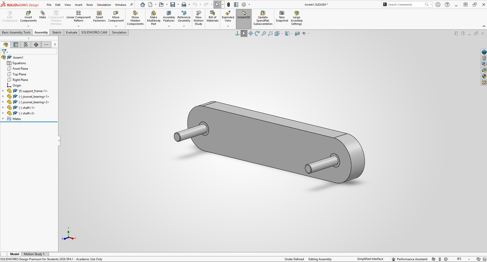
    <figcaption style="font-size: 0.85em; color: gray; margin-top: 5px;">
      Mating shafts through the journal bearings with proper axial positioning
    </figcaption>
  </figure>

  <figure style="display: inline-block; margin: 10px; vertical-align: top;">
    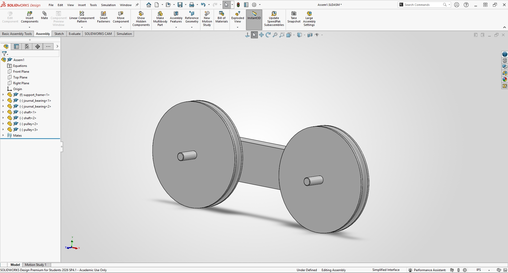
    <figcaption style="font-size: 0.85em; color: gray; margin-top: 5px;">
      Fully assembled 2-shaft pulley drive system (`pulley_system_assembly.sldasm`)
    </figcaption>
  </figure>

---

## 5. Engineering Reflection & Lessons Learned

### What I Learned
- **Direct Revolve Efficiency:** Designing pulleys with an open bore gap in the 2D sketch eliminates extra cut-extrude steps and ensures clean feature trees.
- **Flush Bearing Fits:** Matching bushing lengths precisely to the support plate thickness ($0.500\text{ in}$) prevents uneven edge loading and simplifies back-face assembly referencing.
- **Cantilever Minimization:** Keeping shaft lengths constrained to $1.500\text{ inches}$ minimizes overhang deflection under belt tension loads.

### Time Spent Working on This Project
- **Analytical Calculations & Belt Sizing:** 1.5 hours
- **Part Modeling (Pulley, Shaft, Bearings, Frame):** 3.0 hours
- **Assembly Mating & Alignment:** 2.0 hours
- **Documentation & Formatting:** 1.5 hours
- **Total Time Invested:** **8.0 hours**

  <!-- Master Download Button for All Assets -->
  <a href="A9.zip" download="A9.zip" style="
    background-color: #1976d2; 
    color: white; 
    text-decoration: none;
    padding: 12px 22px; 
    font-size: 0.95em; 
    font-weight: bold; 
    border-radius: 5px; 
    box-shadow: 0 2px 5px rgba(0,0,0,0.15);
    display: inline-block;
    transition: background-color 0.2s;">
    📦 Download All Pulley System CAD Files & Screenshots (.zip)
  </a>

## Resources

References and tools used throughout this project:

<ul style="list-style-type: circle !important; padding-left: 20px;">
  <li style="list-style-type: circle !important; margin-bottom: 4px;">
    SolidWorks Academic Edition
  </li>
  <li style="list-style-type: circle !important; margin-bottom: 4px;">
    McMaster-Carr Online CAD Library
  </li>
  <li style="list-style-type: circle !important; margin-bottom: 4px;">
    Machinery's Handbook 32nd Edition (Fits & Tolerances Reference)
  </li>
</ul>

  
