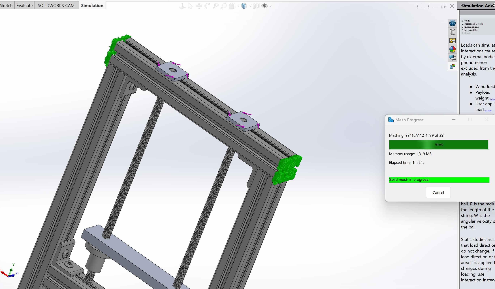
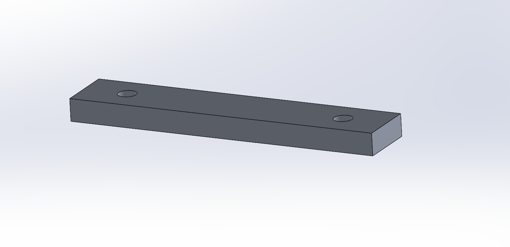
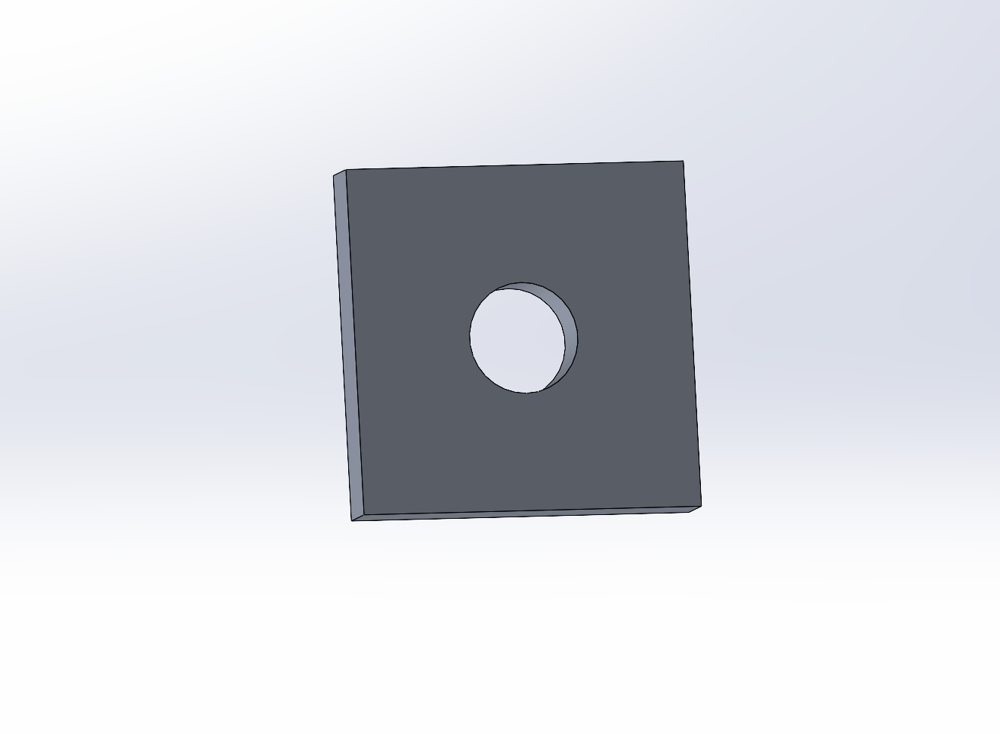
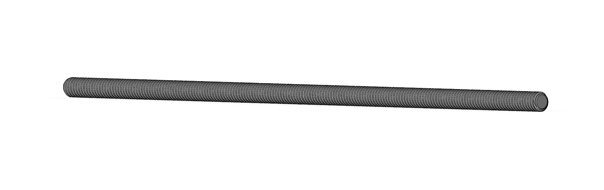
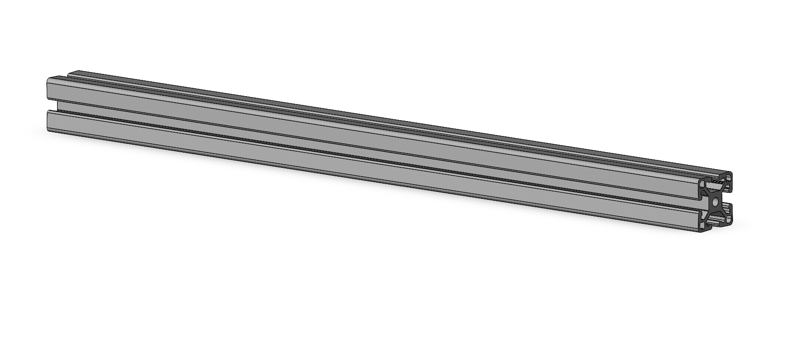
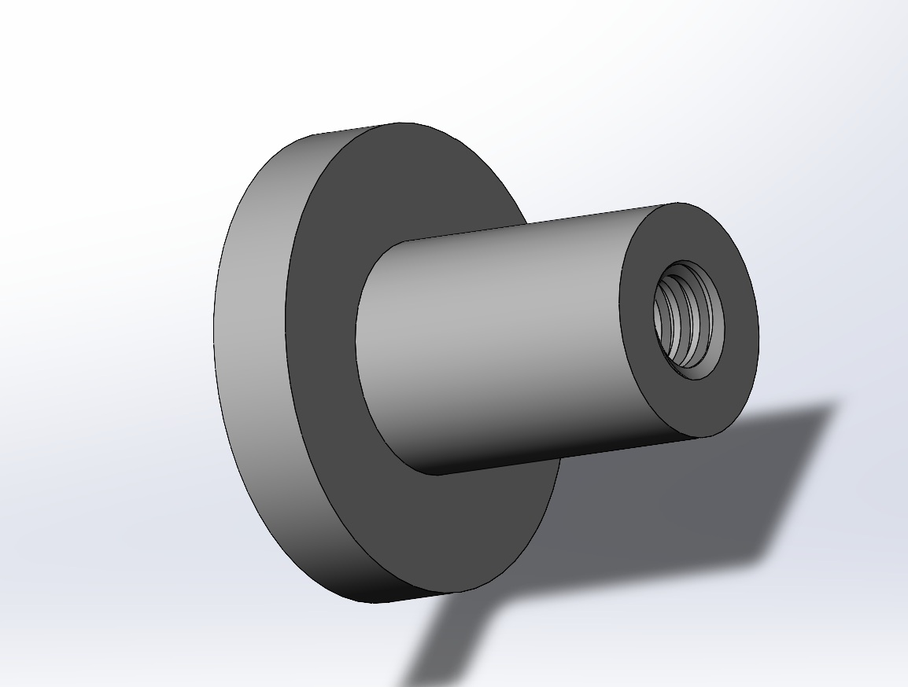
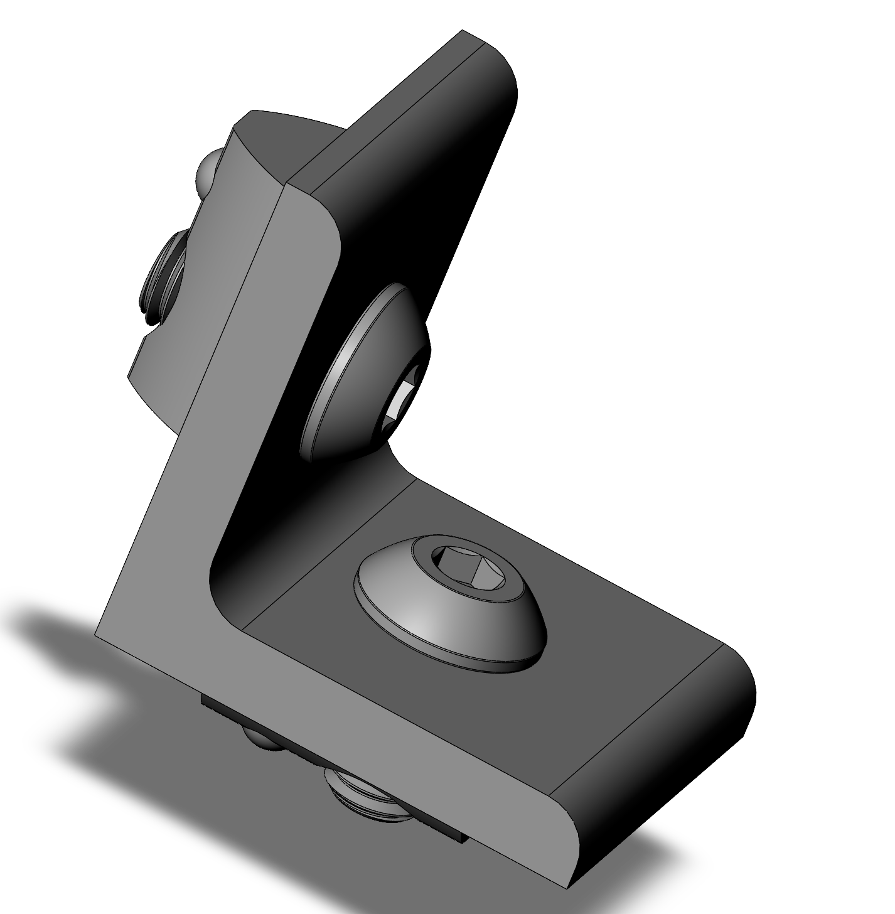
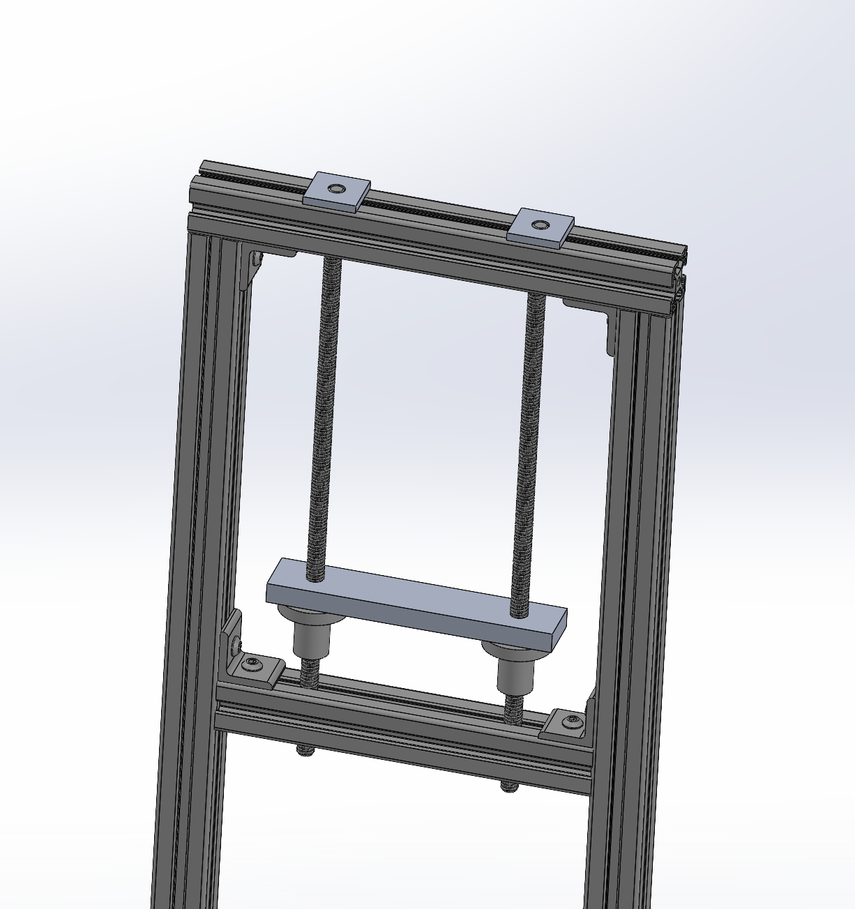

# Motor Selection Design

## Stepper Motor, Mount Bracket & Shaft Coupling (Randy Hoang)

For my portion of the project, I was responsible for selecting the stepper motor, sizing the mounting bracket for bearing stress, and evaluating the flexible shaft coupling for torsional shear and alignment compliance. Based on the required peak input torque of $1.26\text{ N}\cdot\text{m}$ per screw and rotational speed range of $0.39\text{--}19.69\text{ rpm}$ established for the leadscrew drivetrain, I selected a NEMA 23 bipolar hybrid stepper motor ([`6627T161`](https://www.mcmaster.com/6627T161/)), determined the minimum thickness for a 6061-T6 aluminum mounting bracket, and verified a clamp-on flexible beam coupling ([`6208K595`](https://www.mcmaster.com/6208K595/)) to provide documented dimensions for CAD integration and assembly.

  <figure style="display: inline-block; width: 100%; max-width: 900px; margin: 0 auto;">
    <iframe src="Hand Calc A11.pdf" width="100%" height="600px" style="border: 1px solid #ccc; border-radius: 4px;">
      
Your browser does not support iframes. 
         <a href="Hand Calc A11.pdf">Download the Hand Calculations PDF instead.</a>
      

    </iframe>
    <figcaption style="font-size: 0.85em; color: gray; margin-top: 8px;">
      Hand Calculations — Motor Selection, Mount Bracket &amp; Coupler Sizing
    </figcaption>
  </figure>

### Component Selection & Design Notes
- **Stepper Motor Selection ([`6627T161`](https://www.mcmaster.com/6627T161/)):** The selected NEMA 23 bipolar hybrid stepper motor provides a maximum holding torque of $600.4\text{ in}\cdot\text{ozf}$ ($\approx 4.24\text{ N}\cdot\text{m}$), a $1.8^\circ$ full-step increment, a maximum speed rating of $1,300\text{ rpm}$, and a $1/4^{\prime\prime}$ ($0.2498^{\prime\prime}$) D-profile shaft ($3/4^{\prime\prime}$ length) with a $1.86^{\prime\prime}$ mounting bolt pattern and four $0.20^{\prime\prime}$ mounting holes.
- **Motor Mount Bracket Thickness:** Evaluating a 6061-T6 aluminum bracket ($\sigma_y = 276\text{ MPa}$, design safety factor $n_s = 4$) with a $5\text{ mm}$ ($0.005\text{ m}$) fastener diameter under a $1000\text{ N}$ reference load yields an allowable bearing stress of $69\text{ MPa}$ and a minimum bearing thickness of $2.90\text{ mm}$. A plate thickness of **$6.00\text{ mm}$** was selected to ensure structural stiffness and adequate thread/fastener engagement.
- **Flexible Coupling Selection ([`6208K595`](https://www.mcmaster.com/6208K595/)):** Torsional shear analysis for 6061-T6 ($\tau_y = 0.577 \times 276 = 159.3\text{ MPa}$, allowable shear stress $\tau_{\text{allow}} = 39.83\text{ MPa}$ at $n_s = 4$) with a $1/2^{\prime\prime}$ ($12.7\text{ mm}$) bore indicates a minimum outer diameter of $14.2\text{ mm}$ ($0.75\text{ mm}$ minimum wall thickness). Selecting the $1\ 1/4^{\prime\prime}$ ($31.75\text{ mm}$) OD, $2^{\prime\prime}$-long spiral-cut aluminum clamp-on coupling ($1/2^{\prime\prime} \times 1/4^{\prime\prime}$ bores, $115\text{ in}\cdot\text{lbf}$ maximum torque rating) provides substantial torque margin, zero backlash, and accommodation for minor shaft misalignments.
- **Axial Clearance Verification:** Assembly layout must verify that the axial distance between the motor face and the leadscrew accommodates the $3/4^{\prime\prime}$ ($0.75^{\prime\prime}$) motor shaft extension and the $2^{\prime\prime}$ overall coupling length without axial interference.

  <figure style="display: inline-block; width: 100%; max-width: 900px; margin: 0 auto;">
    <iframe src="6627T161.pdf" width="100%" height="600px" style="border: 1px solid #ccc; border-radius: 4px;">
      
Your browser does not support iframes. 
         <a href="6627T161.pdf">Download the McMaster-Carr Stepper Motor Spec Sheet PDF instead.</a>
      

    </iframe>
    <figcaption style="font-size: 0.85em; color: gray; margin-top: 8px;">
      McMaster-Carr Spec Sheet &amp; Drawing — <a href="https://www.mcmaster.com/6627T161/" target="_blank">Part 6627T161 (NEMA 23 Stepper Motor)</a>
    </figcaption>
  </figure>

  <figure style="display: inline-block; width: 100%; max-width: 900px; margin: 0 auto;">
    <iframe src="6208K595.pdf" width="100%" height="600px" style="border: 1px solid #ccc; border-radius: 4px;">
      
Your browser does not support iframes. 
         <a href="6208K595.pdf">Download the McMaster-Carr Shaft Coupling Spec Sheet PDF instead.</a>
      

    </iframe>
    <figcaption style="font-size: 0.85em; color: gray; margin-top: 8px;">
      McMaster-Carr Spec Sheet &amp; Drawing — <a href="https://www.mcmaster.com/6208K595/" target="_blank">Part 6208K595 (1/2" x 1/4" Clamp-On Flexible Coupling)</a>
    </figcaption>
  </figure>

---

### Analytical Calculations

1. **Design Parameters & Material Properties:**
   - Required input torque per screw: $T = 1.26\text{ N}\cdot\text{m}$
   - Crosshead linear travel speed range: $v = 1\text{--}50\text{ mm/min}$ with screw lead $L = 2.54\text{ mm/rev}$ ($0.100\text{ in/rev}$)
   - Design safety factor: $n_s = 4$
   - 6061-T6 Aluminum properties: $\sigma_y = 276\text{ MPa}$, $\tau_y = 0.577 \times 276 = 159.3\text{ MPa}$
   - Reference dimensions: fastener diameter $d_{\text{bolt}} = 5\text{ mm}$ ($0.005\text{ m}$), inner bore $d_i = 12.7\text{ mm}$ ($0.0127\text{ m}$, $1/2^{\prime\prime}$)

2. **Required Rotational Speed Range & Motor Selection:**
   $$N_{\min} = \frac{1\text{ mm/min}}{2.54\text{ mm/rev}} = 0.39\text{ rpm}, \qquad N_{\max} = \frac{50\text{ mm/min}}{2.54\text{ mm/rev}} = 19.69\text{ rpm}$$
   - Selected motor: McMaster-Carr [**6627T161**](https://www.mcmaster.com/6627T161/) (NEMA 23, $600.4\text{ in}\cdot\text{ozf}$ holding torque, $1.8^\circ$/step, $1/4^{\prime\prime}$ D-shaft).

3. **Motor Mount Bracket Minimum Thickness ($t_{\min}$):**
   $$\sigma_{\text{allow}} = \frac{276\text{ MPa}}{4} = 69\text{ MPa}$$
   $$t_{\min} = \frac{1000\text{ N}}{(0.005\text{ m})(69 \times 10^6\text{ N/m}^2)} = 2.90\text{ mm} \rightarrow \mathbf{6.00\text{ mm}} \text{ (selected for stiffness &amp; thread engagement)}$$

4. **Coupler Torsional Shear & Minimum Outer Diameter ($d_{o,\min}$):**
   $$\tau_{\text{allow}} = \frac{159.3\text{ MPa}}{4} = 39.83\text{ MPa}$$
   $$\tau_{\max} = \frac{16 T d_o}{\pi(d_o^4 - d_i^4)} \le 39.83 \times 10^6 \implies d_{o,\min} = \mathbf{14.2\text{ mm}}$$
   $$t_{\text{wall,min}} = \frac{14.2\text{ mm} - 12.7\text{ mm}}{2} = 0.75\text{ mm}$$
   - Selected coupling: McMaster-Carr [**6208K595**](https://www.mcmaster.com/6208K595/) ($1\ 1/4^{\prime\prime}$ / $31.75\text{ mm}$ OD $\ge 14.2\text{ mm}$, $1/2^{\prime\prime} \times 1/4^{\prime\prime}$ bores, $115\text{ in}\cdot\text{lbf}$ maximum torque).

---

### Handoff Specifications for CAD & Assembly

| Component | Part & Material | Key Dimensions | Rating | Assembly & Mounting Notes |
| :--- | :--- | :--- | :--- | :--- |
| **Stepper Motor** | McMaster [**6627T161**](https://www.mcmaster.com/6627T161/) (NEMA 23 Hybrid Stepper) | $2.25^{\prime\prime}$ face ($1.86^{\prime\prime}$ bolt circle, $4 \times 0.20^{\prime\prime}$ holes), $4.24^{\prime\prime}$ body length, $\varnothing 0.2498^{\prime\prime}$ ($1/4^{\prime\prime}$) $\times 0.75^{\prime\prime}$ D-shaft | $600.4\text{ in}\cdot\text{ozf}$ holding torque, $1.8^\circ$/step, $1,300\text{ rpm}$ max | $12.5^{\prime\prime}$ leads (4-wire bipolar); verify shaft and coupler axial clearance |
| **Motor Mount Bracket** | 6061-T6 Aluminum Plate | $6.00\text{ mm}$ thickness (exceeds $2.90\text{ mm}$ bearing minimum), NEMA 23 ($1.86^{\prime\prime}$) mounting pattern | $\sigma_y = 276\text{ MPa}$, $\sigma_{\text{allow}} = 69\text{ MPa}$ ($n_s = 4$) | Sized for structural stiffness and fastener thread engagement |
| **Shaft Coupling** | McMaster [**6208K595**](https://www.mcmaster.com/6208K595/) (Aluminum Spiral Beam, Clamp-On) | $1\ 1/4^{\prime\prime}$ ($31.75\text{ mm}$) OD $\times 2^{\prime\prime}$ overall length, $1/2^{\prime\prime} \times 1/4^{\prime\prime}$ bores, \#8-32 $\times 1/2^{\prime\prime}$ clamp screws | $115\text{ in}\cdot\text{lbf}$ max torque, $10,000\text{ rpm}$ max, $0.015^{\prime\prime}$ parallel / $5^\circ$ angular / $0.01^{\prime\prime}$ axial | Zero backlash; clamps $1/4^{\prime\prime}$ motor shaft to $1/2^{\prime\prime}$ leadscrew |

---

## Analyze and Design a Frame (Noah Nicholson)

For the CAD and frame design portion of the project, I built and integrated the tensile tester assembly ([`Tensile Tester`](A11assm.SLDASM)) using the calculated dimensions and downloaded hardware models.

### CAD Assembly & Component Notes
- **Simulation & Meshing Issue:** When creating the mesh, everything was checked out correctly just as how it was done in previous uses. However this time, the simulation would get stuck at 96% and then get to 99% at the last second before stating my memory usage was too high and failing to generate a model. After trying multiple fixes the outcome stayed the same.  
  

- **Crosshead:** This was designed using the dimensions achieved during last week’s assignment.  
  

- **Motor Mount:** Using the diameter and thickness that was needed in the previous work done for this assignment, this was the result for the motor mount at the top of the frame.  
  

- **Lead Screw:** This was the downloaded file for the lead screw that we chose. To fit our frame I cut the length down from 2 feet to 18 inches.  
  

- **Frame:** This is the framework that was used to make the structure of the tensile tester. The frame piece used here was modified multiple times to fit the varied sections of the tensile tester.  
  

- **Bearing Mount:** This is the mount that was used to connect the lead screw and the crosshead. This model was also downloaded from McMaster and selected due to its proper threading and desirable dimensions for our purposes.  
  

- **Frame Mounting Bracket:** This is another downloaded item from McMaster that was used to connect the different parts of the frame of the tensile tester together.  
  

- **Final Assembly:** This is the final completed assembly of the tensile tester, as shown, all the previously described parts are on this machine and there were many other iterations that failed because of improper measurements of downloaded models or incorrect constraints when mating.  
  

---

## Bill of Materials & Design Cost (Atiba Johnson)

### Bill of Materials

| Item # | Qty | Name | Cost / Item | Total Cost | Purchase Link |
| :---: | :---: | :--- | :---: | :---: | :--- |
| 1 | 1 | Stepper Motor with Square Body, NEMA 23, 600.4 | $240.27 | $240.27 | [Link](https://www.mcmaster.com/6627T161/) |
| 2 | 1 | Clamping Precision Flexible Shaft Coupling, Spiral, Aluminum, for 1/2" x 1/4" Shaft Diameter, 2" Long, 1-1/4" OD | $133.16 | $133.16 | [Link](https://www.mcmaster.com/6208K595/) |
| 3 | 2 | Precision Acme Lead Screw, 1060/Alloy Steel, 1/2"-10 Thread, 2 ft. Long | $65.24 | $130.48 | [Link](https://www.mcmaster.com/6350K61/) |
| 4 | 2 | Precision Acme Flange Nut, 932 Bearing Bronze, 1/2"-10 Thread | $178.60 | $357.20 | [Link](https://www.mcmaster.com/97790A110/) |
| 5 | 4 | T-Slotted Framing Single Rail, 40 mm x 40 mm, 2 ft. Long | $21.15 | $84.60 | [Link](https://www.mcmaster.com/6575N25/) |
| 6 | 8 | T-Slotted Framing Bracket | $7.06 | $56.48 | [Link](https://www.mcmaster.com/5537T937/) |
| 7 | 1 | Alloy Steel Acme Lead Screw Right Hand, 1/2"-10 Thread Size, 2 Feet Long | $39.17 | $39.17 | [Link](https://www.mcmaster.com/93410A112/) |
| **Total** | | | | **$1041.36** | |

### Design Cost

| Person | Hours Worked | Cost/Hour | Total Cost |
| :--- | :---: | :---: | :---: |
| Randy | 4.6 | $35 | $161 |
| Noah | 8.7 | $35 | $304.5 |
| Atiba | 3 | $35 | $105 |

---

### Lessons Learned & Project Takeaways

- **Hardware & Interface Verification:** Checking exact dimensions, shaft profiles, bore sizes, and load ratings upfront saved rework—confirming the NEMA 23 motor (`6627T161`), clamp-on flexible beam coupling (`6208K595`), and `1/2"-10` Acme leadscrews/flange nuts early kept our CAD mates, axial clearances, and safety factors aligned across the team.
- **Designing Beyond Minimum Stress Limits:** Hand calculations for bearing stress and torsional shear establish safe minimums, but practical factors like bracket rigidity, fastener thread engagement, and torque margin drive real-world choices (such as selecting a `6.00 mm` 6061-T6 mount plate over the `2.90 mm` bearing minimum and a `1 1/4"` OD coupling over the `14.2 mm` minimum OD).
- **CAD & Simulation Workflow:** Iterating on frame parts, trimming leadscrew length to fit the assembly, and troubleshooting meshing memory limits highlighted how sensitive full-assembly FEA and mating constraints can be—making clean sub-assemblies and early dimension checks essential.
- **Cost & Scope Tracking:** Keeping a clear BOM alongside labor hours made it easy to track total hardware and engineering costs as parts were selected, updated, and integrated into the final assembly.

  <a href="A11.zip" download="A11.zip" style="
    background-color: #1976d2; 
    color: white; 
    text-decoration: none;
    padding: 12px 22px; 
    font-size: 0.95em; 
    font-weight: bold; 
    border-radius: 5px; 
    box-shadow: 0 2px 5px rgba(0,0,0,0.15);
    display: inline-block;
    transition: background-color 0.2s;">
    📦 Download All Project Files &amp; Calculations (.zip)
  </a>

